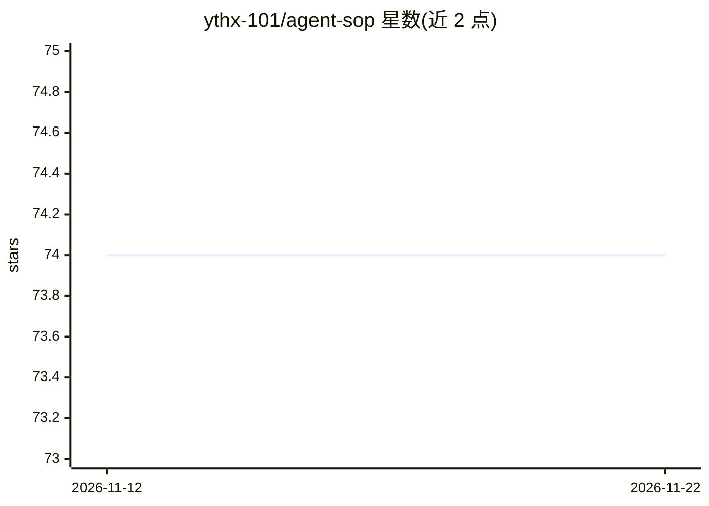

# ythx-101/agent-sop

⭐ 74 · Python · MIT · 推送 2026-11-12 · [GitHub](https://github.com/ythx-101/agent-sop) · 个人维护 · 中文 README

**人类守门的多 Agent 编码 SOP 技能：跨厂商评审与签核**

供编码 Agent（Claude Code、Codex CLI、Gemini CLI 等）加载的 SOP 技能：由发现脚本探测本机已安装的编码 Agent CLI 并做健康探测，按能力而非名称分配 orchestrator/writer/reviewer/scout/monitor 槽位，强制评审者尽量来自与写作者不同的厂商。高风险工作走 research→plan→人审→实现→独立评审→验证→签核包→人工签发→部署的完整流程，低风险走轻量路径；发布/部署/数据写入步骤只能由人类执行，声明须附命令与输出作为证据。以 SKILL.md 加脚本形式提供，需 Python 3.8+ 标准库，经 git clone 装入 Agent 的技能目录。

## 筛选速览

| 维度 | 判定 | 备注 |
|---|---|---|
| AI 角色 | `ai-ecosystem` | LLM/agent 周边工具 |
| 许可风险 | `permissive` | MIT |
| 部署形态 | `None` |  |
| 模型依赖 | — | README 未给出锁定关系 |
| 硬件要求 | — | 无带数字的原话,不猜 |
| 安装摩擦 | `low` | 无编译、无系统依赖或容器化 |
| 成熟度 | — | 结构信号不足 |

## 能力要点

- 发现脚本探测已安装 Agent CLI，按能力分配槽位而非硬编码名单
- 评审者独立性阶梯：优先选择与写作者不同厂商的评审
- 发布/部署/数据写入由人类守门，沉默不视为批准
- 声明必须附命令与捕获输出，评审者重跑安全相关检查

## 适用场景

- 同一台机器上多个编码 Agent CLI 协作完成生产级变更
- 需要审计轨迹与人工签发的部署前评审流程
- 要求评审者与写作者来自不同 AI 厂商以保证独立性

## 场景标签

`多智能体` `编码 Agent` `代码审查` · 领域:Agent 开发

## 证据(README 行号)

> L3: agent-sop is a loadable SOP skill for coding agents (Claude Code, Codex CLI, Gemini CLI and others) that discovers t
> L29: - **Agent-first.** Skills are operated by agents, not hand-configured by humans. The skill guides an agent to detec
> L30: - **Discovered roster, never a hardcoded one.** At task start the orchestrator runs `scripts/discover-roster.py --p

## 星数曲线

2026-11-12 74 → 2026-11-22 74（+0）

---
*卡片 v1 · prompt 1.4 · 生成 2026-11-18 · 置信度 high · 依据 README sha `390e85d41dc1` · [字段定义](../../DATASET.md)*
