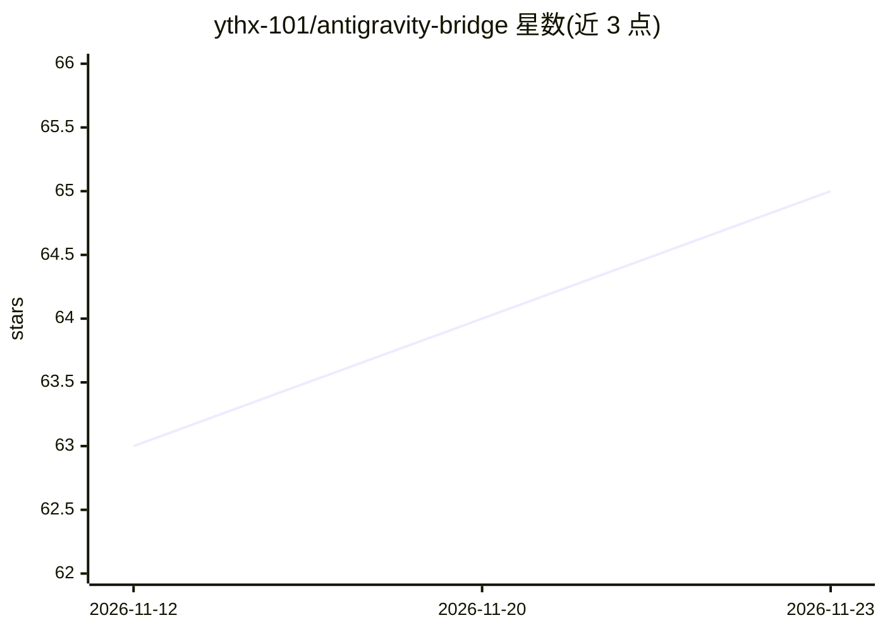

# ythx-101/antigravity-bridge

⭐ 65 · Python · MIT · 推送 2026-11-12 · [GitHub](https://github.com/ythx-101/antigravity-bridge) · 个人维护 · 中文 README

**把 Google Antigravity 桌面端聊天封装成本地 REST API 的非官方桥**

非官方 Python 工具，通过 Chrome DevTools Protocol 连接 macOS 上的 Google Antigravity 桌面应用，将其聊天界面暴露为本地 REST API（端口 19999）：支持同步/异步对话、模型切换、对话历史读取、生成图片计数与 base64 提取，并提供 CLI 别名 ag 与 SSH+CDP 的 IDE agent 触发脚本。消息经 DOM 注入 Lexical 编辑器实现，依赖硬编码模型列表。仅限 macOS + Antigravity 已安装，明确声明违反服务条款、有封号风险，不支持生产/多用户，非 OpenAI API 兼容。

## 筛选速览

| 维度 | 判定 | 备注 |
|---|---|---|
| AI 角色 | `ai-ecosystem` | LLM/agent 周边工具 |
| 许可风险 | `permissive` | MIT |
| 部署形态 | `library` | 以包/库形式分发 |
| 模型依赖 | — | README 未给出锁定关系 |
| 硬件要求 | — | 无带数字的原话,不猜 |
| 安装摩擦 | `low` | 无编译、无系统依赖或容器化 |
| 成熟度 | `idea` | |

## 能力要点

- CDP 注入方式把桌面端聊天转为本地 REST API（同步/异步/轮询）
- 6 个模型切换（Claude Opus/Sonnet、Gemini 系列、GPT-OSS 120B）
- 生成图片计数与 base64 提取端点
- CLI 别名 ag 与 SSH+CDP 的 IDE agent 触发脚本

## 适用场景

- 让自己的脚本或 AI agent 调用 Antigravity 界面里的模型
- 本地零成本跑多模型个人实验
- 通过命令行快速向指定模型提问

## 场景标签

`模型网关` · 领域:Agent 开发

## 证据(README 行号)

> L5: Antigravity Bridge is an unofficial Python tool that connects to the Google Antigravity desktop app on macOS through
> L38: **Antigravity Bridge** wraps Antigravity — Google's AI desktop app — into a local REST API via Chrome DevTools Prot

## 星数曲线

2026-11-12 63 → 2026-11-23 65（+2）

---
*卡片 v1 · prompt 1.4 · 生成 2026-11-18 · 置信度 mid · 依据 README sha `62839a502b55` · [字段定义](../../DATASET.md)*
