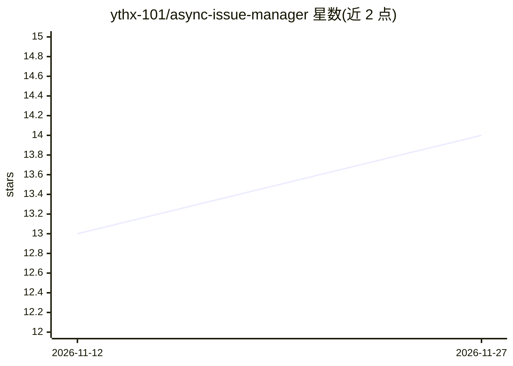

# ythx-101/async-issue-manager

⭐ 14 · Python · MIT · 推送 2026-11-12 · [GitHub](https://github.com/ythx-101/async-issue-manager) · 个人维护 · 中文 README

**给 AI Agent 用的纯本地异步任务管理：Markdown+Git 建 Issue**

以 `.issues/` 目录中的 Markdown 文件为任务载体、Git 追踪历史，提供 4 个纯 Python 标准库脚本（Python 3.8+，零外部依赖）：manager.py 完成 Issue 创建/分配/关闭/统计，broadcast.py 按标签与优先级把 open Issue 匹配给用户配置的 Agent 订阅，inspector.py 巡查 stub、TOOLS.md 引用、闲置 Skill、记忆膨胀并自动去重建单，auto-dispatch.sh 供 cron 每小时调度。派活由用户的主 Agent 判断，系统只负责记录、匹配与广播。可作为 OpenClaw Skill 安装，也可独立用任何能执行 shell 的 Agent 或 crontab 调用。无 Web 界面，不适合多人协作。

## 筛选速览

| 维度 | 判定 | 备注 |
|---|---|---|
| AI 角色 | `ai-ecosystem` | LLM/agent 周边工具 |
| 许可风险 | `permissive` | MIT |
| 部署形态 | `library` | 以包/库形式分发 |
| 模型依赖 | — | README 未给出锁定关系 |
| 硬件要求 | — | 无带数字的原话,不猜 |
| 安装摩擦 | `low` | 无编译、无系统依赖或容器化 |
| 成熟度 | — | 结构信号不足 |

## 能力要点

- 纯本地文件方案：Markdown + index.json + Git，无需账号、网络与数据库
- 巡查系统内置 4 项检查，自动发现问题并按标题去重建 Issue
- 按标签/优先级把 open Issue 广播给配置订阅的多个 Agent
- 可作为 OpenClaw Skill 安装，CLI 亦可被任意 Agent 或 crontab 调用

## 适用场景

- 上班前丢任务给 Agent，下班后查看处理结果
- 让巡查脚本自动发现工作区的 stub、失效引用等问题并建单
- 在多 Agent 场景按标签把不同类型的任务路由给对应 Agent
- 通过 Git 在多台设备间同步任务数据

## 场景标签

`多智能体` · 领域:Agent 开发

## 证据(README 行号)

> L5: **async-issue-manager 是一个纯本地、基于文件的 AI Agent 异步任务管理系统（本地 Issue 管理）：用 `.issues/` 目录里的 Markdown 文件 + Git 记录任务，给在用 OpenC
> L39: - **按标签 / 优先级匹配** — `broadcast.py` 把 open Issue 匹配给订阅的 Agent，最终派活由你的主 Agent 判断
> L246: 能。CLI 是普通 Python 脚本，任何能执行 shell 的 Agent 或 crontab 都可以调用。

## 星数曲线

2026-11-12 13 → 2026-11-27 14（+1）

---
*卡片 v1 · prompt 1.4 · 生成 2026-11-18 · 置信度 mid · 依据 README sha `2032c90390da` · [字段定义](../../DATASET.md)*
