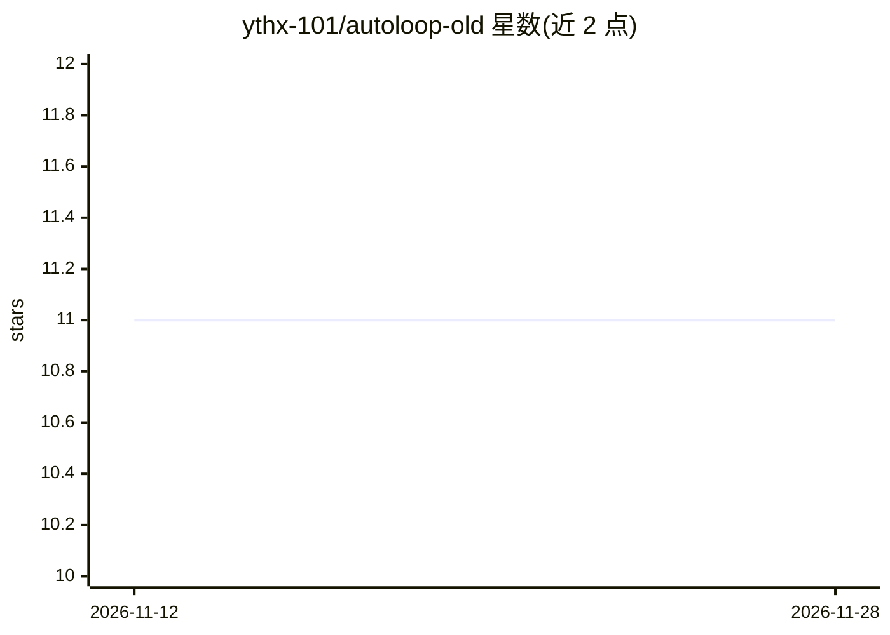

# ythx-101/autoloop-old

⭐ 11 · Shell · 推送 2026-11-12 · [GitHub](https://github.com/ythx-101/autoloop-old) · 个人维护 · 中文 README

**运维自修复管线：cron 轮询 issue 让 Claude Code 修复并验证**

面向自有 Linux 服务器的 GitHub 仓库自动修复管线：cron 定时轮询带 type:service 标签的 issue，通过 headless claude -p 调用 Claude Code 尝试修复，下一个周期执行 issue 内嵌的 verify 块或只读检查做延迟验证，通过即关闭 issue，失败 N 次后打 needs-decision 标签并可选发 Telegram 通知人工。纯 Shell 实现，GitHub 标签充当状态机，无数据库、队列与 webhook；要求 root 权限安装，并声明不适用于公共仓库与多主机集群。

## 筛选速览

| 维度 | 判定 | 备注 |
|---|---|---|
| AI 角色 | `ai-ecosystem` | LLM/agent 周边工具 |
| 许可风险 | `permissive` | — |
| 部署形态 | `library` | 以包/库形式分发 |
| 模型依赖 | locked-api |  |
| 硬件要求 | — | 无带数字的原话,不猜 |
| 安装摩擦 | `low` | 无编译、无系统依赖或容器化 |
| 成熟度 | — | 结构信号不足 |

## 能力要点

- 以 GitHub Issue 标签为状态机，cron 为调度器，无需数据库/队列/webhook
- 延迟验证机制：下一周期运行 issue 内嵌 ```verify 块校验修复
- 失败重试携带上次失败评论作为记忆，N 次失败后升级人工并可选 Telegram 通知
- 以独立 ccworker 用户运行 Claude Code 做隔离

## 适用场景

- 深夜运维告警自动生成 issue 后由管线尝试自动修复
- 自有服务器上低频、单行修复类运维事件的自动化处理
- 为 Solo 开发者或小团队搭建无需额外基础设施的 issue 自动处理流程

## 场景标签

`编码 Agent` `工作流自动化` · 领域:效率与自动化

## 证据(README 行号)

> L3: **AutoLoop is a zero-glue, issue-driven auto-fix pipeline for GitHub repos: cron polls labeled issues, Claude Code (
> L67: AutoLoop is a **zero-glue** pipeline — no orchestrator, no queue, no database. GitHub Issues *are* the state machin
> L174: |`claude` (Claude Code)|`npm install -g @anthropic-ai/claude-code`|

## 星数曲线



2026-11-12 11 → 2026-11-28 11（+0）


---
*卡片 v1 · prompt 1.4 · 生成 2026-11-18 · 置信度 low · 依据 README sha `526767db4857` · [字段定义](../../DATASET.md)*
