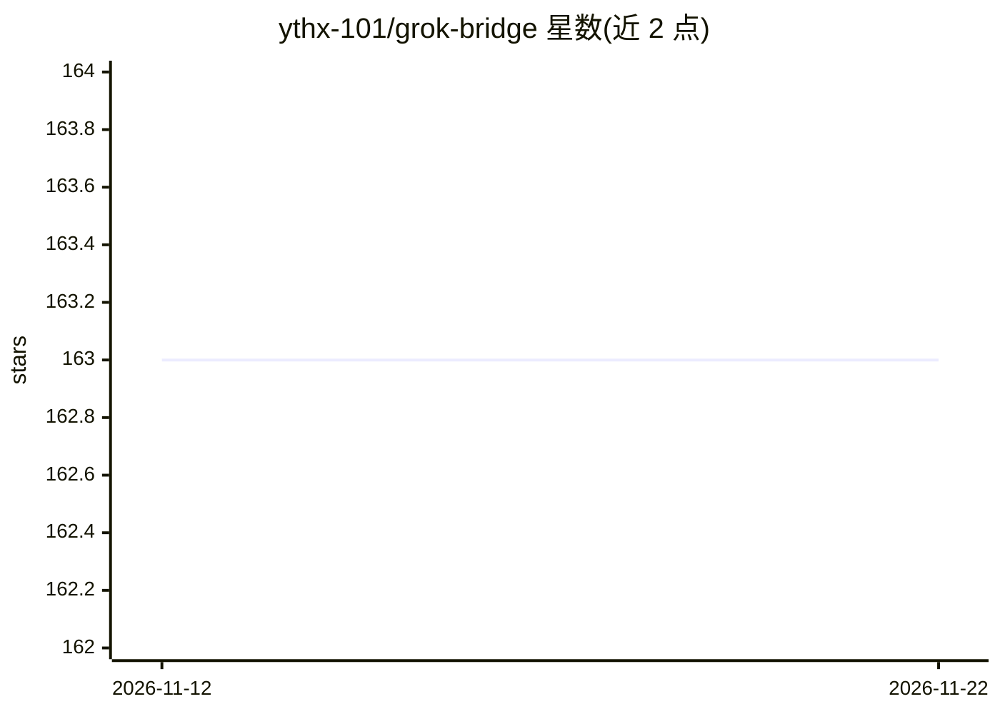

# ythx-101/grok-bridge

⭐ 163 · Python · MIT · 推送 2026-11-12 · [GitHub](https://github.com/ythx-101/grok-bridge) · 个人维护 · 中文 README

**把已登录 Safari 的 Grok 网页变成本地 REST API/CLI**

macOS 上的本地桥接服务：通过 AppleScript 向已登录 grok.com 的 Safari 标签页注入 JavaScript，模拟输入与点击，从 DOM 提取回答，从而暴露 POST /chat、/new、/health、/history 等本地端点，供脚本或 AI agent 以 HTTP 调用 Grok，无需 xAI API key。仅用 Python 标准库，默认绑定 127.0.0.1、使用专用标签页，不申请 macOS 辅助功能权限。限制：仅 macOS+Safari、单会话串行、无流式，且受 grok.com UI 变化影响可能失效。

## 筛选速览

| 维度 | 判定 | 备注 |
|---|---|---|
| AI 角色 | `ai-ecosystem` | LLM/agent 周边工具 |
| 许可风险 | `permissive` | MIT |
| 部署形态 | `None` |  |
| 模型依赖 | — | README 未给出锁定关系 |
| 硬件要求 | — | 无带数字的原话,不猜 |
| 安装摩擦 | `low` | 无编译、无系统依赖或容器化 |
| 成熟度 | — | 结构信号不足 |

## 能力要点

- Safari JavaScript 注入驱动 grok.com，无需 API key 与辅助功能权限
- REST API + 遗留 CLI，提供 /chat、/new、/health、/history 端点
- Python 3 标准库实现，零第三方依赖，默认仅监听 127.0.0.1
- 默认使用专用标签页（window.name=grok-bridge-agent），中文界面可识别发送按钮

## 适用场景

- 在本地脚本中调用自己已登录的 Grok 账号而不用买 API key
- 让 Claude Code 等 AI agent 通过 HTTP 端点访问 Grok
- 通过 SSH 隧道从远程机器访问 Mac 上的 Grok 会话

## 场景标签

`浏览器自动化` · 领域:效率与自动化

## 证据(README 行号)

> L3: grok-bridge turns the Grok web app (grok.com) in your signed-in Safari into a local REST API and CLI on macOS — so y
> L11: - **For:** individuals who want to call their own grok.com account (free or SuperGrok) from local scripts or AI age
> L48: ### REST API (recommended)

## 星数曲线

2026-11-12 163 → 2026-11-22 163（+0）

---
*卡片 v1 · prompt 1.4 · 生成 2026-11-17 · 置信度 high · 依据 README sha `b14bd74eb4e8` · [字段定义](../../DATASET.md)*
