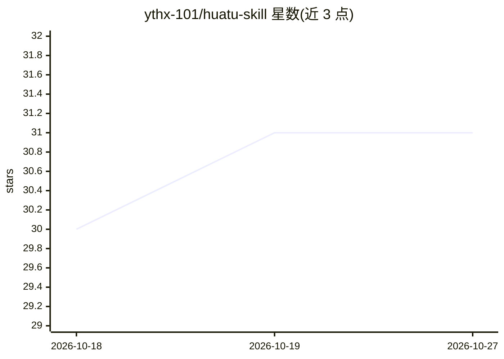

# ythx-101/huatu-skill

⭐ 31 · Python · MIT · 推送 2026-08-24 · [GitHub](https://github.com/ythx-101/huatu-skill) · 个人维护 · 中文 README

**面向 Codex/Agent 的视觉叙事 Skill：把文章做成小红书轮播与 ELI5 解释器**

一个 SKILL.md 格式的 Agent 技能包，供 Codex 等支持 SKILL.md 的 Agent 框架调用，将长文章、研究笔记或草稿转化为两种产物：6–10 页小红书轮播（可编辑 JSON、HTML 预览、1080×1350 PNG、QA 结果）或 3–7 幕 ELI5 单页 HTML 解释器。机制上用 designManifest 记录设计意图，渲染需本地 Chromium 或 Playwright，配 fail-closed 交付检查脚本与双视口 Chromium QA；图片仅接受本地路径，不登录、不自动发布。限制：机械检查通过仍不授权自动发布，最终审美判断留给人。

## 筛选速览

| 维度 | 判定 | 备注 |
|---|---|---|
| AI 角色 | `ai-ecosystem` | LLM/agent 周边工具 |
| 许可风险 | `permissive` | MIT |
| 部署形态 | `None` |  |
| 模型依赖 | — | README 未给出锁定关系 |
| 硬件要求 | — | 无带数字的原话,不猜 |
| 安装摩擦 | `low` | 无编译、无系统依赖或容器化 |
| 成熟度 | — | 结构信号不足 |

## 能力要点

- 两条产品路径：小红书轮播（最终产物 PNG）与 ELI5 解释器（最终产物 HTML）
- designManifest 记录视觉命题、隐喻、节奏与构图意图，可被脚本检查
- fail-closed 交付检查（check_delivery.py）+ 390×844 / 1365×768 双视口 Chromium QA
- 图片仅接受本地文件路径，远程 URL 被拒绝，不登录不自动发布

## 适用场景

- 把博客文章或研究笔记改写成小红书 6–10 页图文轮播
- 把复杂概念做成低文案、大视觉的单页 ELI5 HTML 解释器
- 让 Agent 在渲染前提出多个视觉方向供人工选择

## 场景标签

`AI 写作` · 领域:内容生成

## 证据(README 行号)

> L5: 画图 Skill 是一个面向 Codex / Agent 的视觉叙事 Skill。它先理解论点、关系与情绪，再选择两种产品路径之一：小红书轮播输出可编辑 JSON、HTML 预览、1080×1350 PNG 与 QA；ELI5 Vi
> L39: 也可以克隆到其他支持 `SKILL.md` 的 Agent skills 目录。
> L41: ## 在 Codex 中使用

## 星数曲线

2026-10-18 30 → 2026-10-27 31（+1）

---
*卡片 v1 · prompt 1.4 · 生成 2026-10-26 · 置信度 high · 依据 README sha `d01fc0e12717` · [字段定义](../../DATASET.md)*
