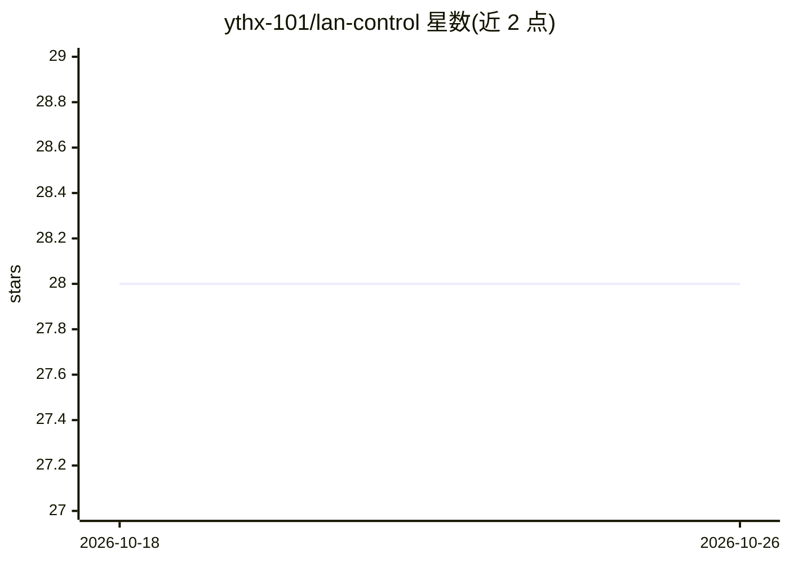

# ythx-101/lan-control

⭐ 28 · Python · Apache-2.0 · 推送 2026-04-18 · [GitHub](https://github.com/ythx-101/lan-control) · 个人维护

**把家用路由器变成局域网设备控制中心的 CLI 工具**

Python 3.8+ 编写的本地优先 CLI 工具：通过 SSH DHCP 扫描、ARP、nmap、mDNS/UPnP 等多方法自动发现局域网内设备，并借助社区维护的 YAML 设备配置文件对路由器、LG 电视、BroadLink 红外、Android 盒子等设备执行控制命令。输出为结构化 JSON，标注为 OpenClaw Skill，可被 AI agent 调用；也支持无路由器 SSH 权限的回退扫描。设备支持分 Verified/Profile/Planned 三档，新设备通过提交 YAML 与 PR 扩展。

## 筛选速览

| 维度 | 判定 | 备注 |
|---|---|---|
| AI 角色 | `ai-enhanced` | 去掉 AI 部分产品仍成立 |
| 许可风险 | `permissive` | Apache-2.0 |
| 部署形态 | `library` | 以包/库形式分发 |
| 模型依赖 | — | README 未给出锁定关系 |
| 硬件要求 | — | 无带数字的原话,不猜 |
| 安装摩擦 | `low` | 无编译、无系统依赖或容器化 |
| 成熟度 | — | 结构信号不足 |

## 能力要点

- 多方法设备发现（SSH DHCP→ARP→nmap→mDNS/UPnP 自动回退）
- YAML 设备配置驱动，添加设备无需改代码，社区 PR 扩展
- 输出结构化 JSON（stdout），标注为 OpenClaw Skill，供 agent 调用
- 本地运行，无需云服务、VPS 或账号

## 适用场景

- 在家用网络中自动发现并列出局域网内所有设备
- 通过 CLI 或 AI agent 控制电视、红外遥控器、Android 盒子等设备
- 检查路由器健康状况（内存、WireGuard、DNS、设备在线状态）
- 为自己的智能设备编写 YAML 配置并贡献到社区注册表

## 场景标签

 · 领域:智能家居/网络设备管理

## 证据(README 行号)

> L8: OpenClaw Skill
> L22: - **Agent-ready** — All output is structured JSON (stdout). Human summaries go to stderr.

## 星数曲线

2026-10-18 28 → 2026-10-26 28（+0）

---
*卡片 v1 · prompt 1.4 · 生成 2026-10-26 · 置信度 low · 依据 README sha `e45b637cee1e` · [字段定义](../../DATASET.md)*
