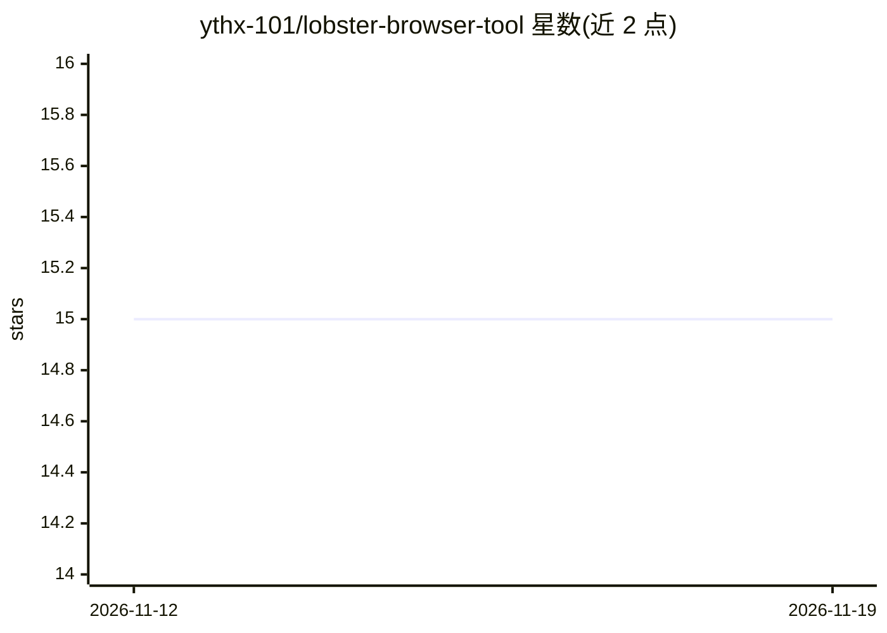

# ythx-101/lobster-browser-tool

⭐ 15 · JavaScript · MIT · 推送 2026-11-12 · [GitHub](https://github.com/ythx-101/lobster-browser-tool) · 个人维护

**让 AI Agent 用 shell 命令操控真实 Chromium 浏览器的 CLI**

基于 Playwright 的 Node.js CLI，未发布到 npm，需从 GitHub 克隆安装，要求 Node.js ≥ 18。启动常驻 Chromium 后，通过 navigate/snapshot/click/type/screenshot/eval 等子命令操作浏览器，每条命令输出带 success 字段的 JSON 便于 Agent 解析。浏览器默认无头运行，使用持久化 profile 保存登录态；analyze 命令可截图并调用 Gemini 视觉模型分析（需自行提供 API key）。作者声明不适合大规模爬取、复杂多标签工作流与强反检测站点。

## 筛选速览

| 维度 | 判定 | 备注 |
|---|---|---|
| AI 角色 | `ai-ecosystem` | LLM/agent 周边工具 |
| 许可风险 | `permissive` | MIT |
| 部署形态 | `library` | 以包/库形式分发 |
| 模型依赖 | — | README 未给出锁定关系 |
| 硬件要求 | — | 无带数字的原话,不猜 |
| 安装摩擦 | `low` | 无编译、无系统依赖或容器化 |
| 成熟度 | — | 结构信号不足 |

## 能力要点

- 零配置 shell 命令操控 Chromium，无需编写 Playwright 代码
- 每条命令输出带 success/error 字段的 JSON，便于 Agent 解析
- 持久化 profile 保留 cookies 与登录态，跨 stop/start 存活
- analyze 命令截图后交 Gemini 视觉分析，模型可配置

## 适用场景

- 给能执行 shell 命令的 AI Agent 提供现成的浏览器操作工具
- 在无桌面的服务器上做网页截图与页面结构检查
- 自动化填写登录表单等简单页面交互

## 场景标签

`浏览器自动化` · 领域:效率与自动化

## 证据(README 行号)

> L3: Lobster Browser Tool is a zero-config Node.js CLI that lets AI agents and scripts control a real Chromium browser (v
> L9: - Give an AI agent that can run shell commands (Claude Code, Codex, OpenClaw and similar) a browser tool, without wr

## 星数曲线

2026-11-12 15 → 2026-11-19 15（+0）

---
*卡片 v1 · prompt 1.4 · 生成 2026-11-18 · 置信度 high · 依据 README sha `d337fb5a78c0` · [字段定义](../../DATASET.md)*
