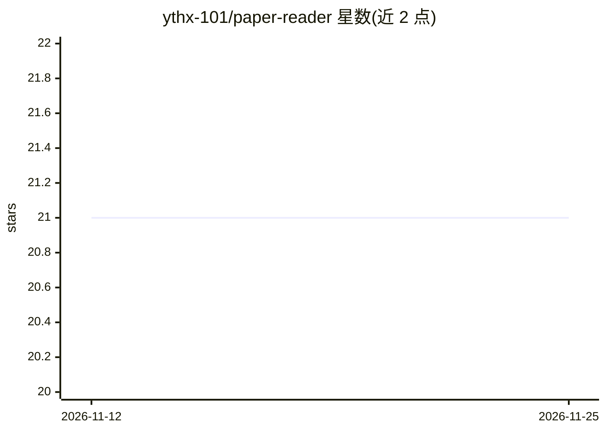

# ythx-101/paper-reader

⭐ 21 · MIT · 推送 2026-11-12 · [GitHub](https://github.com/ythx-101/paper-reader) · 个人维护 · 中文 README

**给 Claude Code 等 agent 的论文图解技能：出处可溯、评审把关**

面向 Claude Code 等 AI agent 的技能（SKILL.md）：输入一篇论文，通过合法途径（Unpaywall/PMC/arXiv、作者主页、免费补充材料等）获取原文，整理每行带出处的带数字事实表，按 PaperBanana 五角色流程出图（数据图用代码画、示意图手写 SVG），强模型逐张评审忠实度，P0 问题不清零不交付，最后用 Kami 排版成可发 X（4 张）或小红书（6–9 张）的 PNG。不使用 Sci-Hub 等盗版渠道，不替用户自动发帖。适合做论文科普图文的创作者、研究者和学生。

## 筛选速览

| 维度 | 判定 | 备注 |
|---|---|---|
| AI 角色 | `ai-native` | 本体是模型或模型工具 |
| 许可风险 | `permissive` | MIT |
| 部署形态 | `library` | 以包/库形式分发 |
| 模型依赖 | — | README 未给出锁定关系 |
| 硬件要求 | — | 无带数字的原话,不猜 |
| 安装摩擦 | `low` | 无编译、无系统依赖或容器化 |
| 成熟度 | — | 结构信号不足 |

## 能力要点

- 事实表每行含结论、数字、图表出处与 URL，无出处说法不上图
- PaperBanana 五角色流程出图，数据图一律用代码绘制
- 强模型忠实度评审，P0 问题不清零不交付
- 仅走合法获取渠道，新闻稿只当线索不作为数据来源

## 适用场景

- 把单篇实证论文做成可发 X / 小红书的图解组图
- 科研科普时确保图中每个数字可回溯到论文图表
- 拿不到全文时让技能起草向作者索取单行本的邮件

## 场景标签

`科研工具` `AI 写作` · 领域:内容生成

## 证据(README 行号)

> L5: 一个给 Claude Code 等 AI agent 用的技能（skill）。你给它一篇论文和一个标题，它会合法地找到原文、整理带出处的事实表、按 PaperBanana 的五角色流程出图，再让强模型逐张评审忠实度，最后用 Kami
> L30: **paper-reader** is an agent skill (for Claude Code and similar agents) that turns an academic paper into a faithfu

## 星数曲线

2026-11-12 21 → 2026-11-25 21（+0）

---
*卡片 v1 · prompt 1.4 · 生成 2026-11-18 · 置信度 mid · 依据 README sha `a2265bf19d30` · [字段定义](../../DATASET.md)*
