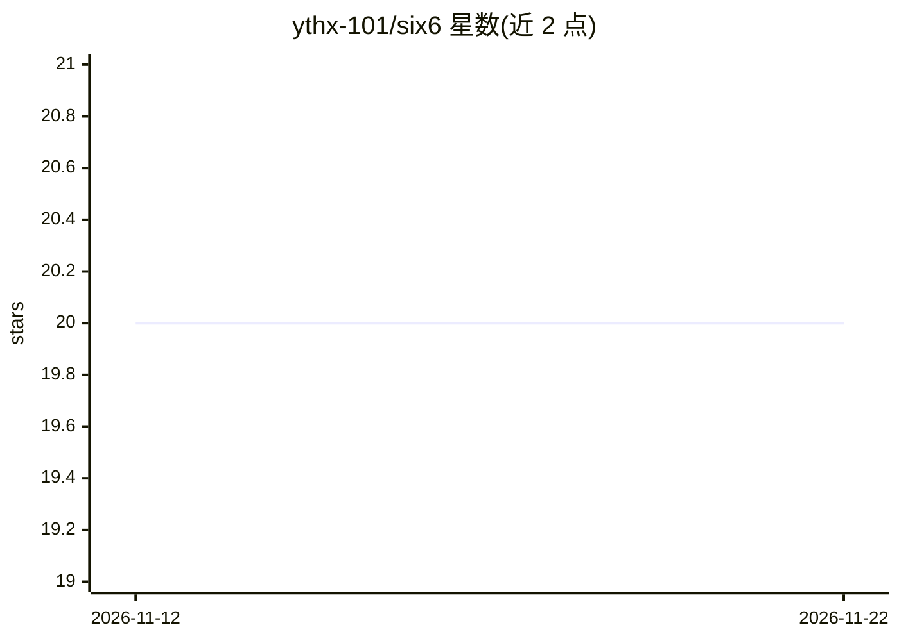

# ythx-101/six6

⭐ 20 · Python · 推送 2026-11-12 · [GitHub](https://github.com/ythx-101/six6) · 个人维护 · 中文 README

**给 AI Agent 的零依赖文件式记忆与认知模块集（6 模块）**

面向 OpenClaw 及自建 agent 开发者的 Python 工具集：6 个互不导入的模块分别提供短期/长期记忆、夜间反思、随机联想生成想法、想法生命周期管理（成熟后经 gh 建 GitHub Issue）、收件箱任务队列与 cron 心跳。状态仅通过 Markdown/JSONL 文件交换，仅用标准库，不依赖向量数据库、不做语义搜索。meditation 与 daydream 模块可选接入 OpenAI/Anthropic 兼容 LLM API，可用 cron/systemd 模板调度，也可脱离 OpenClaw 独立使用单个模块。

## 筛选速览

| 维度 | 判定 | 备注 |
|---|---|---|
| AI 角色 | `ai-ecosystem` | LLM/agent 周边工具 |
| 许可风险 | `permissive` | — |
| 部署形态 | `None` |  |
| 模型依赖 | — | README 未给出锁定关系 |
| 硬件要求 | — | 无带数字的原话,不猜 |
| 安装摩擦 | `low` | 无编译、无系统依赖或容器化 |
| 成熟度 | — | 结构信号不足 |

## 能力要点

- 6 个模块互不导入，仅通过 Markdown/JSONL 文件共享状态
- 零第三方依赖，仅用 Python 标准库，无需向量数据库
- 想法种子成熟度≥80 时自动经 gh 创建 GitHub Issue
- 提供 init/validate/doctor/pulse 运行时入口与 cron/systemd 调度模板

## 适用场景

- 给 OpenClaw 或自建 agent 添加文件式长期记忆
- 用 cron/systemd 驱动低成本的后台反思与想法生成
- 管理 AI 生成的想法生命周期并落为 GitHub Issue

## 场景标签

`Agent 记忆` · 领域:Agent 开发

## 证据(README 行号)

> L14: **six6** is a zero-dependency, file-based memory and cognition toolkit for AI agents (built for OpenClaw). Six inde
> L22: - You want to add persistent AI agent memory (long-term, file-based) to OpenClaw or your own agent.

## 星数曲线

2026-11-12 20 → 2026-11-22 20（+0）

---
*卡片 v1 · prompt 1.4 · 生成 2026-11-18 · 置信度 high · 依据 README sha `387c18e6d3a3` · [字段定义](../../DATASET.md)*
