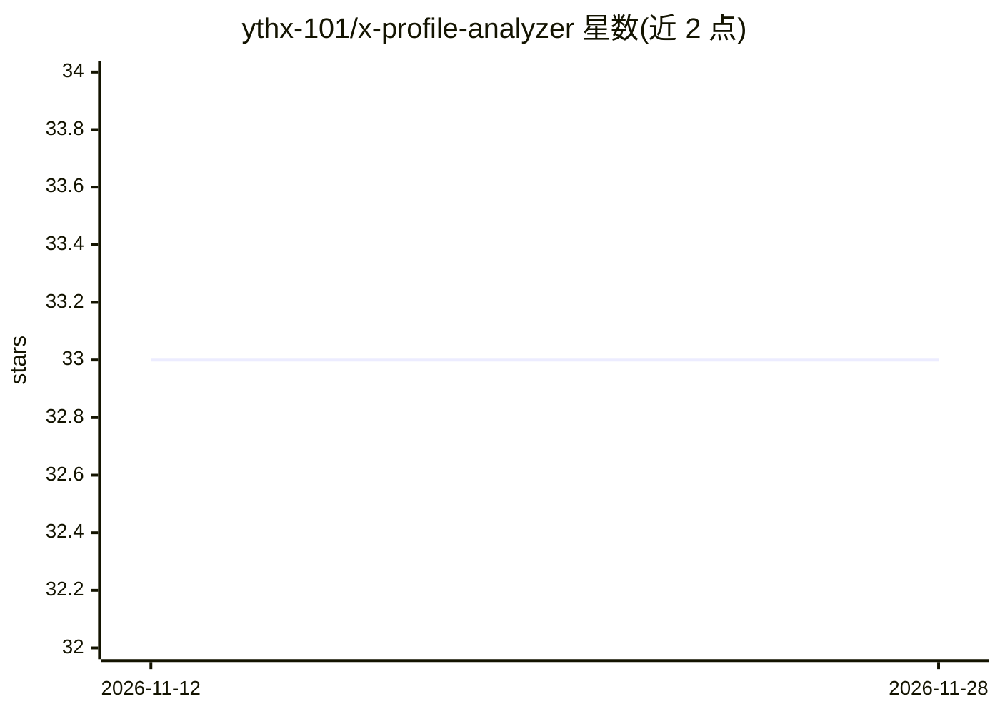

# ythx-101/x-profile-analyzer

⭐ 33 · Python · MIT · 推送 2026-11-12 · [GitHub](https://github.com/ythx-101/x-profile-analyzer) · 个人维护 · 中文 README

**无需 X API 的推特用户画像分析工具：抓公开推文生成 10 维报告**

给一个 X/Twitter 用户名，通过 Nitter + Camofox 抓取最近最多约 300 条公开推文，再用 MiniMax 或任意 OpenAI 兼容大模型（OpenAI、DeepSeek 等）生成 10 个维度的中文用户画像报告（话题偏好、写作风格、深层动机、活跃时间热力图等），其中热力图由本地统计生成。也支持 --no-analyze 模式只导出结构化推文数据。零 pip 依赖（Python 3.7+），但抓取必须依赖 Camofox 运行在 localhost:9377；Nitter 单账号历史上限约 300 条，无法分析私密账号，报告为 AI 推断仅供参考。

## 筛选速览

| 维度 | 判定 | 备注 |
|---|---|---|
| AI 角色 | `ai-native` | 本体是模型或模型工具 |
| 许可风险 | `permissive` | MIT |
| 部署形态 | `None` |  |
| 模型依赖 | — | README 未给出锁定关系 |
| 硬件要求 | — | 无带数字的原话,不猜 |
| 安装摩擦 | `low` | 无编译、无系统依赖或容器化 |
| 成熟度 | — | 结构信号不足 |

## 能力要点

- 无需 X API Key、无需登录即可抓取最多约 300 条公开推文
- 10 维度画像报告：第 1–9 维由 LLM 生成，第 10 维热力图本地统计
- 支持 MiniMax 与任意 OpenAI 兼容接口（OpenAI、DeepSeek 等）
- --no-analyze 模式可只导出推文数据交给用户自己的 AI

## 适用场景

- 做内容、BD 或调研前快速了解一个 X 账号
- OpenClaw 用户或 AI agent 玩家获取账号画像技能
- 批量导出公开推文结构化数据供自有 agent 分析

## 场景标签

`网页抓取` · 领域:效率与自动化

## 证据(README 行号)

> L3: 给一个 X/Twitter 用户名，**无需 X API Key、无需登录**，通过 Nitter + Camofox 抓取最近最多约 300 条公开推文，再用 MiniMax 或任意 OpenAI 兼容大模型（如 DeepSeek
> L61:        → LLM（MiniMax / OpenAI 兼容）生成第 1–9 维

## 星数曲线

2026-11-12 33 → 2026-11-28 33（+0）

---
*卡片 v1 · prompt 1.4 · 生成 2026-11-18 · 置信度 high · 依据 README sha `0c5f26c9c3f9` · [字段定义](../../DATASET.md)*
