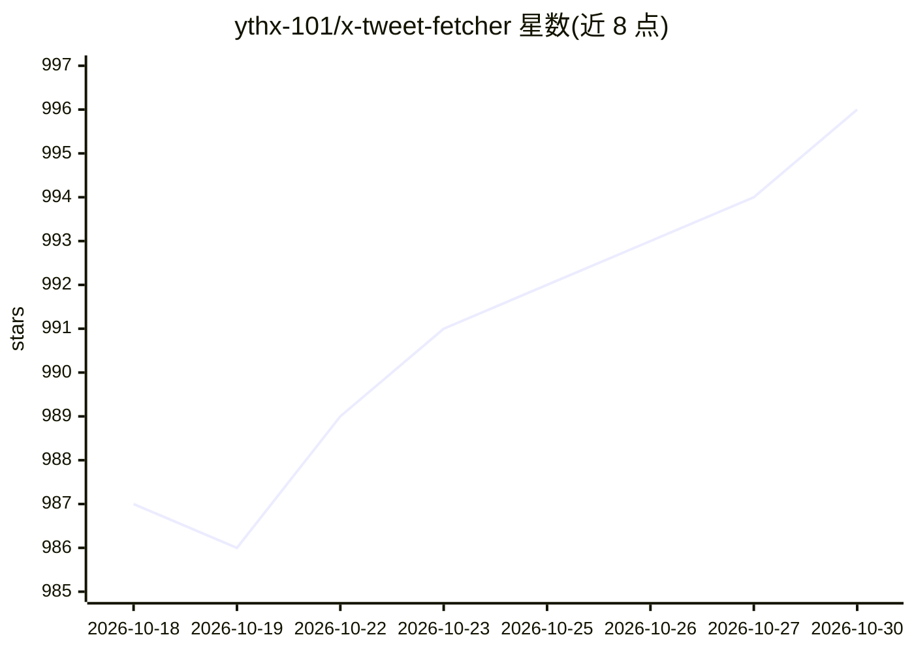

# ythx-101/x-tweet-fetcher

⭐ 996 · Python · MIT · 推送 2026-10-14 · [GitHub](https://github.com/ythx-101/x-tweet-fetcher) · [官网](https://github.com/ythx-101/openclaw-qa) · 个人维护 · 中文 README

**给 AI agent 用的 X/Twitter 内容抓取工具，免登录免 API key**

面向 AI agent 的 X/Twitter 数据获取工具（Python/CLI）：支持抓取单条推文、回复、用户时间线、搜索、列表与 X 文章，无需登录或 API key。核心机制是三后端智能路由——FxTwitter（零依赖，单推）、Nitter（直接 HTTP，时间线/搜索）、浏览器驱动（Camofox 或 Playwright，覆盖列表与文章），后端间自动回退。所有后端归一化为统一的 Tweet/Reply/Profile/Article schema，错误以机器可读的 error_code 返回。可选 --ledger 将结果去重归档进 SQLite 并支持离线查询。需 Python 3.10+；时间线/搜索依赖自建或可用的 Nitter 实例。

## 筛选速览

| 维度 | 判定 | 备注 |
|---|---|---|
| AI 角色 | `ai-ecosystem` | LLM/agent 周边工具 |
| 许可风险 | `permissive` | MIT |
| 部署形态 | `self-host` | docker 或自建部署 |
| 模型依赖 | — | README 未给出锁定关系 |
| 硬件要求 | — | 无带数字的原话,不猜 |
| 安装摩擦 | `low` | 无编译、无系统依赖或容器化 |
| 成熟度 | — | 结构信号不足 |

## 能力要点

- 三后端智能路由（FxTwitter/Nitter/浏览器）自动回退
- 统一 JSON schema（Tweet/Reply/Profile/Article）
- 机器可读错误码（rate_limited/all_backends_failed 等），便于 agent 分支处理
- --ledger SQLite 去重归档与离线查询，兼容 OpenClaw tweets 表

## 适用场景

- 让 AI agent 在对话中直接读取推文、时间线或 X 文章
- 用 cron 增量监控提及（mentions）并归档到本地推文库
- 无 X API 付费订阅的情况下做时间线/搜索数据采集

## 场景标签

`网页抓取` · 领域:效率与自动化

## 证据(README 行号)

> L24: **x-tweet-fetcher** solves this with **smart backend routing**: FxTwitter for single tweets (zero deps), Nitter for
> L167: - **OpenClaw** — AI agent framework this tool grew up in
> L3: **Fetch X/Twitter tweets, replies, timelines, lists, and articles — no login, no API keys.**

## 星数曲线

2026-10-18 987 → 2026-10-30 996（+9）

---
*卡片 v1 · prompt 1.4 · 生成 2026-10-21 · 置信度 mid · 依据 README sha `acaefddf9a92` · [字段定义](../../DATASET.md)*
