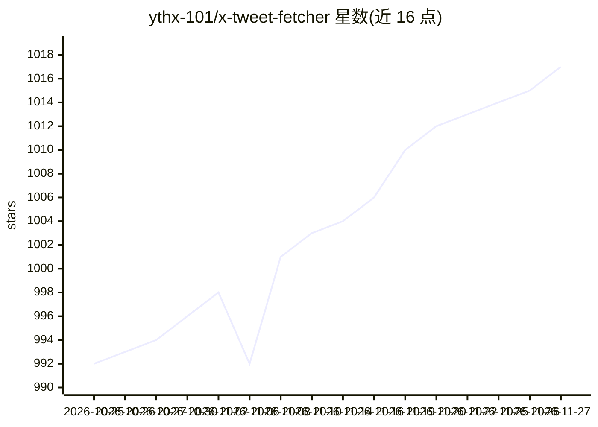

# ythx-101/x-tweet-fetcher

⭐ 1,017 · Python · MIT · 推送 2026-11-12 · [GitHub](https://github.com/ythx-101/x-tweet-fetcher) · [官网](https://github.com/ythx-101/openclaw-qa) · 个人维护 · 中文 README

**免登录免 API 给 AI agent 抓取推特内容的 CLI/库**

x-tweet-fetcher（xtf）是面向 AI agent 与开发者的 Python CLI 和库，抓取 X/Twitter 的推文、回复、时间线、搜索、Lists 与 X Articles，无需登录或 API key。机制：三个后端路由——FxTwitter（单条推文，零依赖）、Nitter（时间线/搜索，需自建实例）、浏览器驱动（Camofox/Playwright，X Articles），自动回退并输出统一 JSON，错误带机器可读 error_code。可用 --ledger 存入 SQLite 推文库去重并离线查询。仅只读，不在 PyPI，需从源码安装。

## 筛选速览

| 维度 | 判定 | 备注 |
|---|---|---|
| AI 角色 | `ai-ecosystem` | LLM/agent 周边工具 |
| 许可风险 | `permissive` | MIT |
| 部署形态 | `self-host` | docker 或自建部署 |
| 模型依赖 | — | README 未给出锁定关系 |
| 硬件要求 | — | 无带数字的原话,不猜 |
| 安装摩擦 | `low` | 无编译、无系统依赖或容器化 |
| 成熟度 | — | 结构信号不足 |

## 能力要点

- FxTwitter/Nitter/浏览器三后端自动回退，输出统一 JSON schema
- 错误携带机器可读 error_code，供 agent 按码分支处理
- --ledger 将抓取结果去重存档 SQLite 并支持离线查询
- 仓库附带 SKILL.md，供命令行类 agent 直接调用

## 适用场景

- 让 agent 按需读取推文、时间线或 List，无需处理 X 凭据
- 用统一 JSON 格式把推特内容喂给下游 prompt
- 搭建小型本地推特存档库并离线检索
- 以 cron 增量监控 mentions（退出码友好）

## 场景标签

`网页抓取` · 领域:效率与自动化

## 证据(README 行号)

> L13: **x-tweet-fetcher (`xtf`) is a Python CLI and library that lets AI agents and developers fetch X/Twitter tweets, re
> L17: 免登录、免 API key 抓取 X（推特）的推文、回复、时间线、搜索、Lists 和长文（X Articles）。适合给 AI agent（OpenClaw、Claude Code 等能跑命令行的 agent）当“读推特”的工具
> L82: **Errors are machine-readable.** Every failure carries `error` (human message) plus `error_code` — one of `invalid_

## 星数曲线

2026-10-25 992 → 2026-11-27 1,017（+25）

---
*卡片 v1 · prompt 1.4 · 生成 2026-11-25 · 置信度 mid · 依据 README sha `ee1e212608d0` · [字段定义](../../DATASET.md)*
