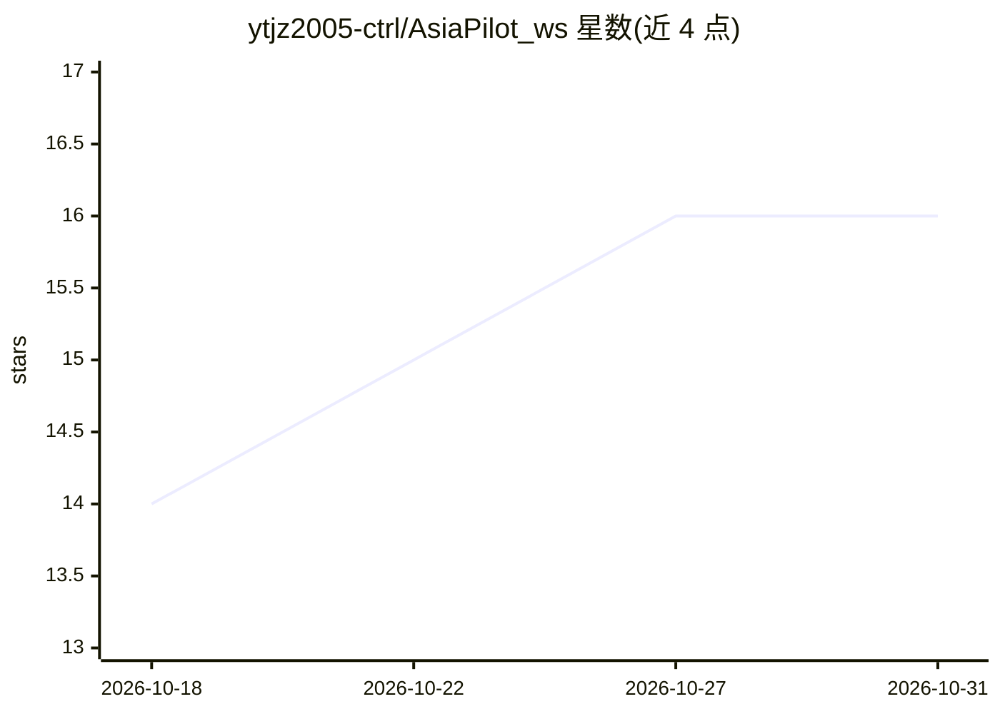

# ytjz2005-ctrl/AsiaPilot_ws

⭐ 16 · Python · 推送 2026-05-12 · [GitHub](https://github.com/ytjz2005-ctrl/AsiaPilot_ws) · 个人维护

**可微分物理无人机避障框架：MAVROS 桥接神经网络规划器与 PX4**

基于上海交大提出的可微分物理端到端敏捷飞行避障框架的工程化实现：通过 MAVROS 节点将神经网络端到端规划器与 PX4 飞控连接，形成从视觉/状态输入到 Gazebo 物理仿真的完整闭环，面向真机部署。仓库直接内置预训练权重与第三方大文件，无需额外下载。运行环境限定 Ubuntu 20.04 + ROS Noetic + Python 3.11 + PyTorch 2.0 以上，需自行编译 PX4 v1.13.3；训练需另参考官方训练框架。

## 筛选速览

| 维度 | 判定 | 备注 |
|---|---|---|
| AI 角色 | `ai-native` | 本体是模型或模型工具 |
| 许可风险 | `none` | — |
| 部署形态 | `library` | 以包/库形式分发 |
| 模型依赖 | — | README 未给出锁定关系 |
| 硬件要求 | — | 无带数字的原话,不猜 |
| 安装摩擦 | `low` | 无编译、无系统依赖或容器化 |
| 成熟度 | — | 结构信号不足 |

## 能力要点

- MAVROS 桥接神经网络规划器与 PX4 飞控
- 视觉输入→NN 规划→MAVROS 指令→PX4 响应→Gazebo 仿真的完整闭环
- 预训练权重与第三方大文件直接内置仓库，克隆即用

## 适用场景

- 在 Gazebo 仿真中运行端到端敏捷飞行避障
- 将神经网络避障规划器对接 PX4 飞控做真机部署验证
- 在官方框架基础上做二次开发与部署实验

## 场景标签

 · 领域:机器人/无人机控制

## 证据(README 行号)

> L8: This project is an improved and engineering-oriented implementation based on the **"Differentiable Physics-Based End
> L24: - 🌉 **Flight Controller Bridge**: This is the core contribution of this project. Through MAVROS nodes, we successfu

## 星数曲线

2026-10-18 14 → 2026-10-31 16（+2）

---
*卡片 v1 · prompt 1.4 · 生成 2026-10-30 · 置信度 mid · 依据 README sha `6388122fa55f` · [字段定义](../../DATASET.md)*
