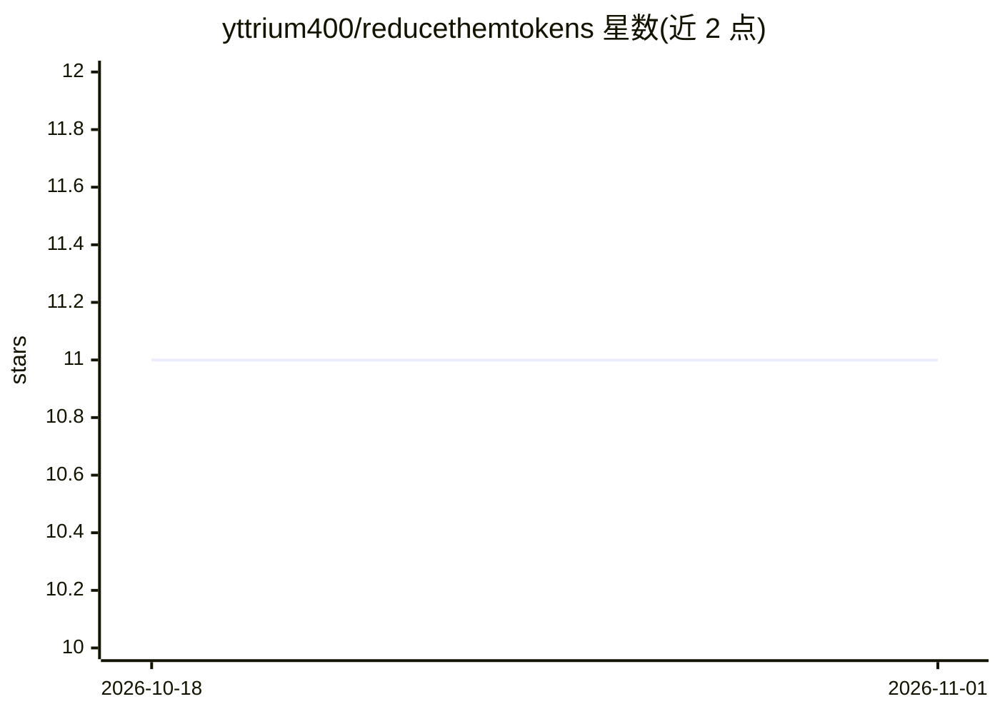

# yttrium400/reducethemtokens

⭐ 11 · Python · MIT · 推送 2026-06-13 · [GitHub](https://github.com/yttrium400/reducethemtokens) · 个人维护

**把代码仓库压缩成结构骨架，降低 LLM token 消耗的 CLI 工具**

rtt 用 tree-sitter 解析仓库每个文件，抽取 imports、函数签名、类层次与方法列表，生成紧凑纯文本骨架（Django 3,020 文件实测 90.9% 缩减），写入 .rtt/context.txt 并向 Claude Code、Cursor、Copilot 等 10 种 agent 配置文件注入读取指令；安装 git pre-commit 钩子自动再生成，支持 --no-tests 与 --max-tokens 控制骨架大小。面向使用编码 agent 的开发者，覆盖 15 种语言，提供 CLI 与 Python API。定位为定向检索之前的结构定位层，非检索替代。

## 筛选速览

| 维度 | 判定 | 备注 |
|---|---|---|
| AI 角色 | `ai-ecosystem` | LLM/agent 周边工具 |
| 许可风险 | `permissive` | MIT |
| 部署形态 | `library` | 以包/库形式分发 |
| 模型依赖 | — | README 未给出锁定关系 |
| 硬件要求 | — | 无带数字的原话,不猜 |
| 安装摩擦 | `low` | 无编译、无系统依赖或容器化 |
| 成熟度 | — | 结构信号不足 |

## 能力要点

- tree-sitter 解析 AST 抽取符号骨架，实测 90.9% token 缩减
- 自动注入 10 种编码 agent 配置（Claude Code/Cursor/Copilot 等）
- git pre-commit 钩子与 CI 方案保持骨架更新
- 支持 15 种语言，含 audit 校验抽取准确率

## 适用场景

- 让编码 agent 在陌生仓库快速定位要改的文件，减少探索性读取
- 在 ChatGPT/Claude.ai 等无内置检索的界面给 LLM 完整仓库结构
- CI 代码审查机器人需要确定性、可复现的仓库上下文

## 场景标签

 · 领域:开发者工具/LLM 上下文工程

## 证据(README 行号)

> L11: `rtt` extracts every file's imports, function signatures, class hierarchies, and method
> L109: This writes `.rtt/context.txt` (the skeleton) and adds a short instruction to every
> L162: |Claude Code|`CLAUDE.md`|

## 星数曲线

2026-10-18 11 → 2026-11-01 11（+0）

---
*卡片 v1 · prompt 1.4 · 生成 2026-11-01 · 置信度 high · 依据 README sha `2df533a769c7` · [字段定义](../../DATASET.md)*
