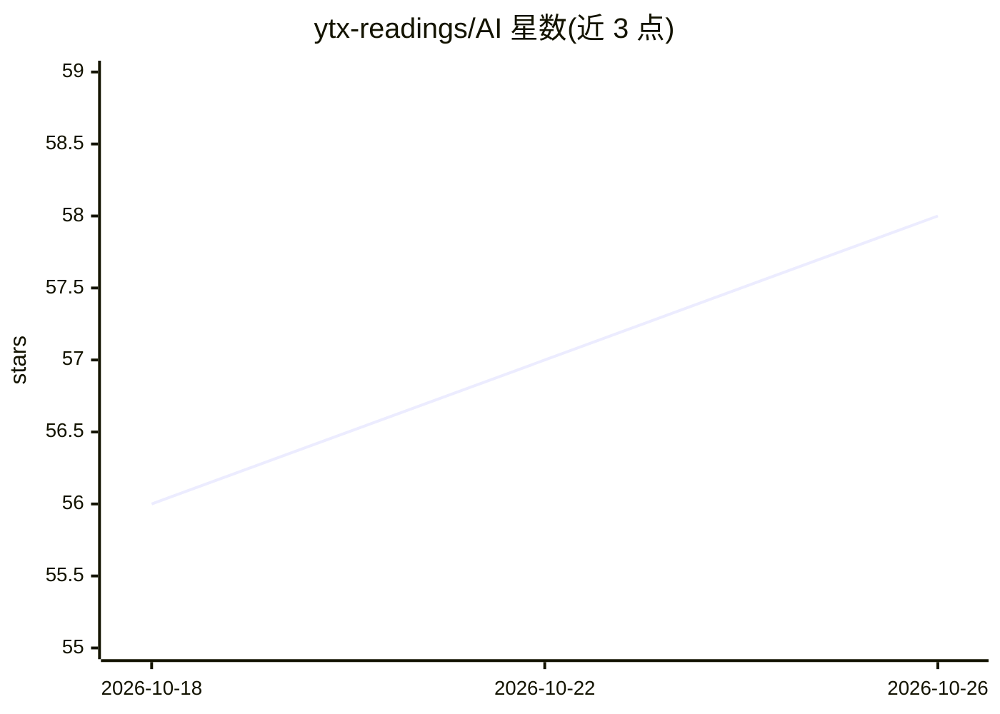

# ytx-readings/AI

⭐ 58 · 推送 2026-04-06 · [GitHub](https://github.com/ytx-readings/AI) · [官网](https://ytx-readings.github.io/AI/) · 个人维护

**AI 书籍与论文的收集仓库**

仅包含标题为 'AI Books and Papers' 的 README，正文为两个条目：Books 与 Papers，表明这是一个收集 AI 相关书籍和论文资料的仓库。README 未提供更多说明、安装方式、内容来源或组织结构信息。给需要查找 AI 学习资料的开发者与科研人员参考。

## 筛选速览

| 维度 | 判定 | 备注 |
|---|---|---|
| AI 角色 | `ai-knowledge` | 知识聚合/清单类 |
| 许可风险 | `none` | — |
| 部署形态 | `None` |  |
| 模型依赖 | — | README 未给出锁定关系 |
| 硬件要求 | — | 无带数字的原话,不猜 |
| 安装摩擦 | `low` | 无编译、无系统依赖或容器化 |
| 成熟度 | — | 结构信号不足 |

## 能力要点

- 收集 AI 相关书籍
- 收集 AI 相关论文

## 适用场景

- 查找 AI 书籍与论文资料

## 场景标签

`精选清单` · 领域:学习与行业

## 证据(README 行号)

> L1: # AI Books and Papers
> L3: * Books
> L4: * Papers

## 星数曲线

2026-10-18 56 → 2026-10-26 58（+2）

---
*卡片 v1 · prompt 1.4 · 生成 2026-10-24 · 置信度 low · 依据 README sha `c6a2843576f2` · [字段定义](../../DATASET.md)*
