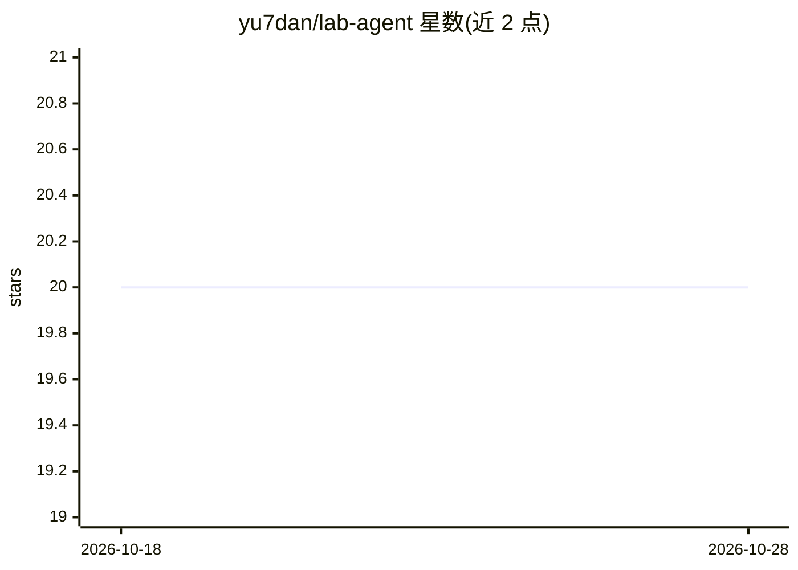

# yu7dan/lab-agent

⭐ 20 · TypeScript · Apache-2.0 · 推送 2026-10-27 · [GitHub](https://github.com/yu7dan/lab-agent) · 个人维护 · 中文 README

**终端双 Agent 编排的 coding agent：写作者改码、审查者独立验收**

面向终端的开源 coding agent，由 `lab`（产品 CLI，配置/诊断/启动/编排）与 `lab-engine`（执行层：TUI、工具、会话、模型调用）组成。核心机制是 `lab supervise` 双 Agent 监督：writer 修改代码，wrapper 执行用户指定的验收命令并采集 diff，auditor 在独立进程、只读工具集与新上下文中基于证据给出 accept/reject/needs_human，工件写入 `.lab/`。模型接入支持 DeepSeek（默认）、Anthropic 及任意 Anthropic 兼容端点。限制：监督非沙箱，writer 可执行任意用户级命令；要求工作区干净；桌面端已停止维护归档。

## 筛选速览

| 维度 | 判定 | 备注 |
|---|---|---|
| AI 角色 | `ai-native` | 本体是模型或模型工具 |
| 许可风险 | `permissive` | Apache-2.0 |
| 部署形态 | `desktop` | 安装包/桌面程序 |
| 模型依赖 | locked-api |  |
| 硬件要求 | — | 无带数字的原话,不猜 |
| 安装摩擦 | `low` | 无编译、无系统依赖或容器化 |
| 成熟度 | `idea` | |

## 能力要点

- 双 Agent 监督：writer 改码 + auditor 独立只读审查，结论为 accept/reject/needs_human
- 证据化验收：审查者须引用命令输出、diff、测试结果，工件写入 .lab/
- 确定性 gate：验收失败或越界改动不会被 auditor 的 accept 覆盖
- 支持 DeepSeek / Anthropic / 任意 Anthropic 兼容端点，CLI 优先可在 CI 复现

## 适用场景

- 在终端用自然语言驱动代码修复、解释与测试修复任务
- 让独立审查 Agent 验收代码改动，避免只凭模型自述通过
- 在 CI 中以 headless 模式（lab -p + JSON 输出）执行一次性任务

## 场景标签

 · 领域:开发工具/AI 编程助手

## 证据(README 行号)

> L5: **一个面向终端的开源 coding agent，正在长出独立的监督者。**
> L21: 1. **写作者 + 审查者**：一个 Agent 改代码，另一个 Agent 在独立上下文里只读审查；
> L26: 监督者已在 `lab supervise` 中提供预览：writer 先改代码，wrapper 执行你指定的验收命令并采集 diff，auditor 在独立进程、只读工具集和新上下文中审查证据；确定性 gate 保证验收失败或越界

## 星数曲线

2026-10-18 20 → 2026-10-28 20（+0）

---
*卡片 v1 · prompt 1.4 · 生成 2026-10-28 · 置信度 high · 依据 README sha `68f11cd99a28` · [字段定义](../../DATASET.md)*
