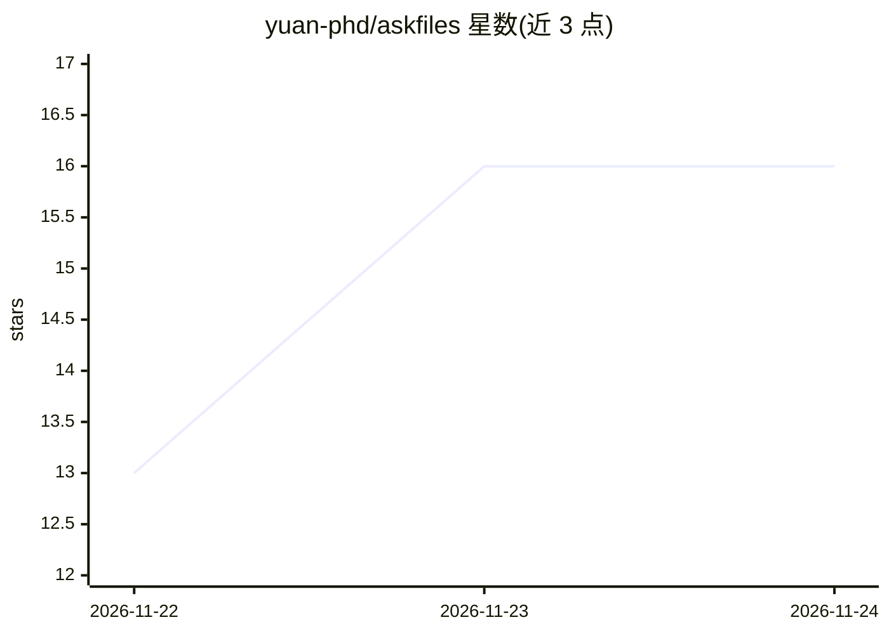

# yuan-phd/askfiles

⭐ 22 · JavaScript · Apache-2.0 · 推送 2026-11-21 · [GitHub](https://github.com/yuan-phd/askfiles) · [官网](https://github.com/yuan-phd/askfiles/releases/latest) · 个人维护 · 中文 README

**Mac/Windows 本地文档问答应用：引用可核验的私有 RAG**

Electron 桌面应用，对本机文档（PDF/Office/Markdown/文本）提问，回答带编号引用并标注文件、章节与页码；每句回答与所引段落核对，不成立的引用被替换或移除，无来源支持的句子以短剑标记。内置 Ollama 运行 Qwen3 14B（按内存选择 4-bit/3-bit），检索采用 bge-m3 向量搜索加 BM25 与倒数排序融合；文档存储、解析、OCR 与向量库使用 headless 模式的 AnythingLLM。数据不出本机，首次下载模型后可离线运行。仅提供 Apple silicon Mac 与 Windows x64 安装包，无 Intel Mac 与 Linux 版本。

## 筛选速览

| 维度 | 判定 | 备注 |
|---|---|---|
| AI 角色 | `ai-native` | 本体是模型或模型工具 |
| 许可风险 | `permissive` | Apache-2.0 |
| 部署形态 | `desktop` | 安装包/桌面程序 |
| 模型依赖 | local-ok | 支持本地模型 |
| 硬件要求 | — | 无带数字的原话,不猜 |
| 安装摩擦 | `low` | 无编译、无系统依赖或容器化 |
| 成熟度 | — | 结构信号不足 |

## 能力要点

- 每句回答与所引段落核对，不支持的句子以 † 标记
- 全本地运行：模型、嵌入、索引与 OCR 均在本机，仅监听 127.0.0.1
- bge-m3 向量搜索 + BM25 + 倒数排序融合的混合检索，按章节切分
- 在密封留出集上公布准确率数据，公开评测方法与案例研究

## 适用场景

- 在本机私有文档库中提问并要求逐句可溯源的回答
- 处理涉密或敏感文档且不允许数据外发
- 在多份文档间对比同一主题章节
- 离线环境下检索与浏览文档库（Browse/Find/Graph）

## 场景标签

`文档问答` · 领域:知识与检索

## 证据(README 行号)

> L5: **Ask questions about your own documents and get answers that cite the file, section and page, with everything runni
> L21: - **Fully local.** The language model, the embeddings, the search index and text recognition all run on the machine
> L101: AskFiles is an Electron app. Its main process starts three local processes, all bound to 127.0.0.1, and owns the r

## 星数曲线

2026-11-22 13 → 2026-11-24 16（+3）

---
*卡片 v1 · prompt 1.4 · 生成 2026-11-22 · 置信度 high · 依据 README sha `fa5d71715a9e` · [字段定义](../../DATASET.md)*
