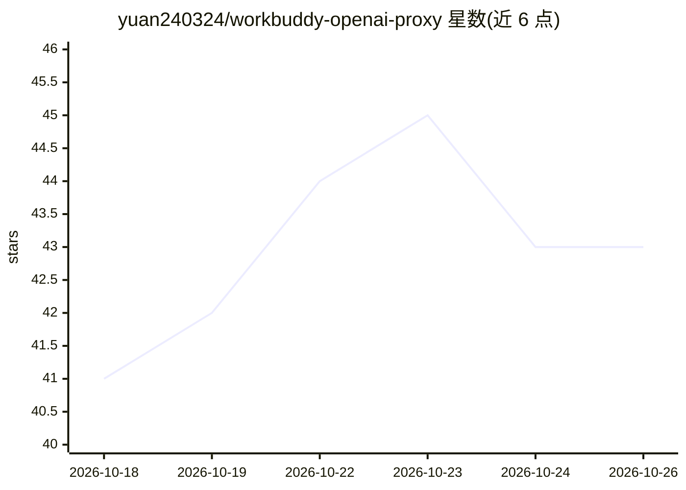

# yuan240324/workbuddy-openai-proxy

⭐ 43 · JavaScript · MIT · 推送 2026-09-27 · [GitHub](https://github.com/yuan240324/workbuddy-openai-proxy) · 个人维护 · 中文 README

**把 WorkBuddy/CodeBuddy 额度转成本机 OpenAI/Anthropic 兼容 API 的代理**

零依赖 Node.js 本机代理：将腾讯 WorkBuddy / CodeBuddy 账号额度（国内版 copilot.tencent.com 与国际版 codebuddy.ai / workbuddy.ai）包装为 OpenAI Chat Completions、Anthropic Messages 及 OpenAI Responses 兼容接口，供 TraeWork / TRAE / Cursor 等 OpenAI 兼容客户端接入。机制含多账号池自动轮换（额度耗尽/失败换号、站点降级）、上下文压缩、网页控制台、路径后缀容错。仅需 Node≥18，git clone 后 node server.mjs 直接运行，仅监听 127.0.0.1，不做多人共享网关。真实上游端到端仅在 Windows + Node 24 验证过。

## 筛选速览

| 维度 | 判定 | 备注 |
|---|---|---|
| AI 角色 | `ai-ecosystem` | LLM/agent 周边工具 |
| 许可风险 | `permissive` | MIT |
| 部署形态 | `self-host` | docker 或自建部署 |
| 模型依赖 | — | README 未给出锁定关系 |
| 硬件要求 | — | 无带数字的原话,不猜 |
| 安装摩擦 | `low` | 无编译、无系统依赖或容器化 |
| 成熟度 | — | 结构信号不足 |

## 能力要点

- 零依赖：全部源码只用 Node 内置模块，无 npm install / Docker
- 多站点（国内版+国际版）统一代理与按模型自动路由
- 多账号池：额度耗尽/请求失败自动换号，支持站点降级
- OpenAI Chat Completions / Anthropic Messages / Responses 三种兼容层与内置网页控制台

## 适用场景

- 在 TraeWork / Cursor 等客户端里把 WorkBuddy/CodeBuddy 额度当自定义模型使用
- 本机多账号池轮换使用多个 CodeBuddy 账号额度
- 通过控制台查看登录态、用量统计与切换模型

## 场景标签

`模型网关` · 领域:Agent 开发

## 证据(README 行号)

> L5: 把 **WorkBuddy / CodeBuddy 账号额度（国内版 + 国际版）**
> L6: 包装成本机上的 **OpenAI 兼容 + Anthropic 兼容** 接口，供 **TraeWork / TRAE / TraeCode CLI / Cherry Studio / Cursor** 等
> L117: - **监听**：默认只绑 `127.0.0.1:8788`，不对局域网/公网暴露，带本地 API Key 鉴权。

## 星数曲线

2026-10-18 41 → 2026-10-26 43（+2）

---
*卡片 v1 · prompt 1.4 · 生成 2026-10-25 · 置信度 mid · 依据 README sha `0b4451e80256` · [字段定义](../../DATASET.md)*
