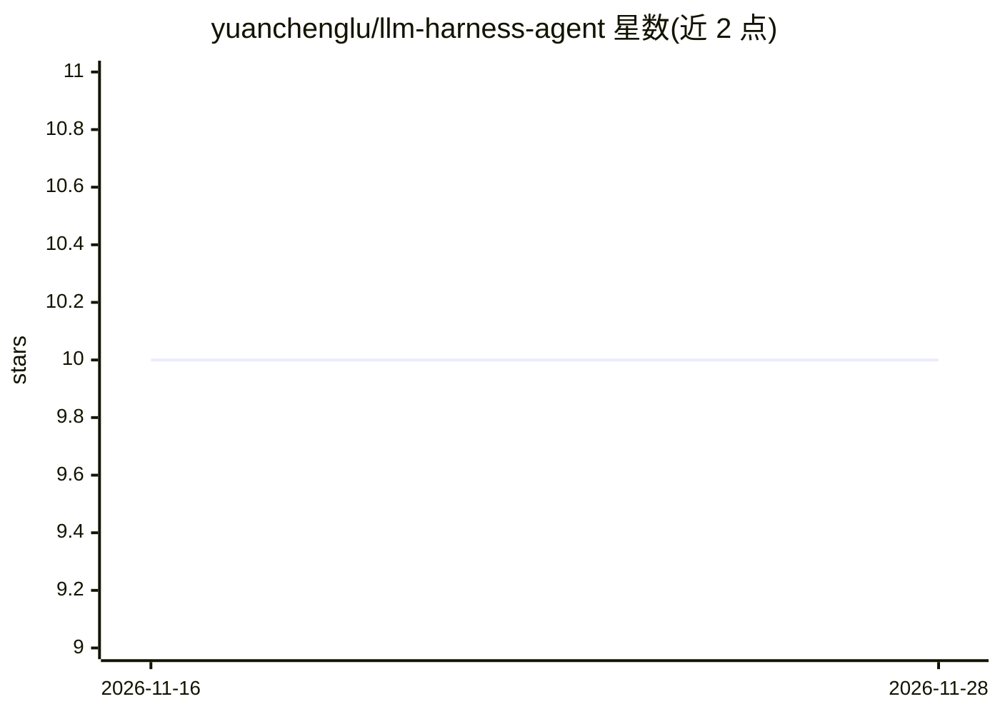

# yuanchenglu/llm-harness-agent

⭐ 10 · HTML · NOASSERTION · 推送 2026-10-08 · [GitHub](https://github.com/yuanchenglu/llm-harness-agent) · [官网](https://study.starseas.org/deepseek) · 个人维护 · 中文 README

**面向 agent 开发者的 LLM Harness 理论与博士论文知识库**

该仓库定位为研究论文、产品规格、架构决策与实验摘要的知识库，而非可执行的 Runtime 代码仓库。内容包含 7 篇「可靠长程智能体」博士研究论文（含研究问题、可反驳假设与实验协议，写作已完成但未执行正式实验）、18 篇核心创新点文章、9 款 Agent 产品校准对比等。围绕「模型能力不等于产品能力」的论点，阐述 Harness 作为协议层/控制层/证据层的架构，适合研究 agent 工程方法论的读者阅读与讨论。

## 筛选速览

| 维度 | 判定 | 备注 |
|---|---|---|
| AI 角色 | `ai-knowledge` | 知识聚合/清单类 |
| 许可风险 | `none` | NOASSERTION |
| 部署形态 | `None` |  |
| 模型依赖 | — | README 未给出锁定关系 |
| 硬件要求 | — | 无带数字的原话,不猜 |
| 安装摩擦 | `low` | 无编译、无系统依赖或容器化 |
| 成熟度 | `idea` | |

## 能力要点

- 7 篇博士研究论文系列，逐篇含可反驳假设与实验协议（59,325 汉字、72 条参考文献）
- 18 项核心创新点文章：PlanGraph、Memory 编译、Checkpoint、上下文分配等
- 9 款 Agent 产品校准对比（Hermes/Claude Code/Cursor 等）
- 以 STATUS.md 与 stage-gates.json 跟踪生产发布验证状态

## 适用场景

- 研究长程 Agent 的计划、记忆与验证机制设计
- 为 Agent Harness 架构决策寻找理论框架与讨论入口
- 对比多款 Agent 产品的实现边界

## 场景标签

 · 领域:AI 基础设施/研究知识库

## 证据(README 行号)

> L11: 3. **本仓库发布一条「可靠长程智能体」博士研究论文系列（7 篇）**：每篇包含研究问题、可反驳假设、方法规范与对照实验协议，并随附《证据核对与实验执行说明》。写作与内部自查已完成，**未执行正式实验、不含实验结果**。
> L12: 4. **本仓库是研究、产品规格、架构决策与实验摘要知识库**，不是当前 DeepSeekAgent Runtime 的完整可执行代码仓库，也不单独证明生产版本已经发布。
> L17: > **「长程」（long-horizon）**：任务需要连续运行几十上百步、跨会话完成，而不是一问一答。**当前状态：写作与内部自查已完成；未执行正式实验，不含实验结果。** 合计 7 篇 · 59,325 汉字 · 72 条参

## 星数曲线

2026-11-16 10 → 2026-11-28 10（+0）

---
*卡片 v1 · prompt 1.4 · 生成 2026-11-19 · 置信度 high · 依据 README sha `60750918afea` · [字段定义](../../DATASET.md)*
