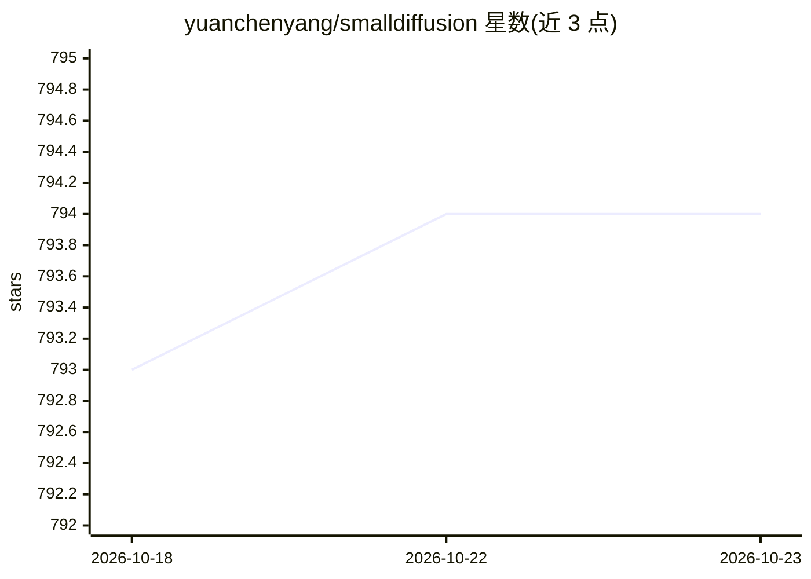

# yuanchenyang/smalldiffusion

⭐ 794 · Python · MIT · 推送 2026-04-08 · [GitHub](https://github.com/yuanchenyang/smalldiffusion) · [官网](https://www.chenyang.co/diffusion.html) · 个人维护

**轻量扩散/流模型训练与采样库，面向实验与快速上手**

以 Python 库形式提供的扩散与流模型（flow matching）训练与采样工具：核心训练与采样代码少于 100 行，支持 MLP、U-Net、DiT 三类模型，支持 score/v/data 多种预测目标参数化，内置 7 种噪声调度与 classifier-free guidance 条件训练。提供 2D 玩具数据集及 FashionMNIST、CIFAR-10、ImageNet 训练示例，附 diffusers 封装可对预训练潜扩散模型采样；多 GPU 训练经由 Hugging Face Accelerate。要求 Python 3.10+，pip 安装。

## 筛选速览

| 维度 | 判定 | 备注 |
|---|---|---|
| AI 角色 | `ai-native` | 本体是模型或模型工具 |
| 许可风险 | `permissive` | MIT |
| 部署形态 | `library` | 以包/库形式分发 |
| 模型依赖 | — | README 未给出锁定关系 |
| 硬件要求 | — | 无带数字的原话,不猜 |
| 安装摩擦 | `medium` | 含编译或系统依赖之一 |
| 成熟度 | — | 结构信号不足 |

## 能力要点

- 核心训练与采样代码少于 100 行，面向实验扩展
- 支持 MLP/U-Net/DiT 模型与 score/flow/data 多种参数化
- DDPM/DDIM/加速采样统一在 gam、mu 两参数下
- 提供 Hugging Face diffusers 预训练潜扩散模型采样封装

## 适用场景

- 快速实验新的扩散模型结构或采样算法
- 在玩具数据集或 FashionMNIST/CIFAR-10 上训练扩散模型
- 对预训练 Stable Diffusion 类模型调试采样参数

## 场景标签

 · 领域:机器学习/生成模型

## 证据(README 行号)

> L9: A lightweight diffusion library for training and sampling from diffusion and
> L13:  - Example training code (with close to SOTA FID): FashionMNIST, CIFAR10, Imagenet

## 星数曲线

2026-10-18 793 → 2026-10-23 794（+1）

---
*卡片 v1 · prompt 1.4 · 生成 2026-10-21 · 置信度 high · 依据 README sha `35e9a3189465` · [字段定义](../../DATASET.md)*
