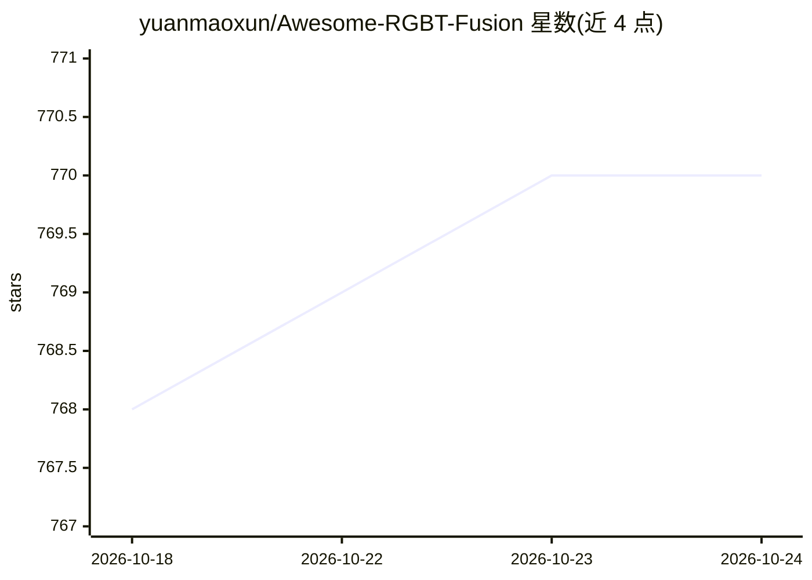

# yuanmaoxun/Awesome-RGBT-Fusion

⭐ 770 · 推送 2026-10-15 · [GitHub](https://github.com/yuanmaoxun/Awesome-RGBT-Fusion) · 个人维护

**RGB-T 融合方向的论文/代码/数据集策展清单**

收录深度学习 RGB-T（可见光-红外）融合方法、代码与数据集的论文清单，覆盖多光谱行人检测、RGB-T 空中目标检测、语义分割、显著目标检测、人群计数与融合跟踪等方向。以多光谱行人检测为例，整理了 14 个数据集的年份、模态、图像量与类别数，以及 KAIST 标注改进、评测代码等工具；论文按视觉语言模型感知、预训练通用模型、模态偏差、像素级融合、光照感知、特征对齐、模态翻译与蒸馏、融合架构等主题分类，条目附 PDF 与代码链接，持续更新中。

## 筛选速览

| 维度 | 判定 | 备注 |
|---|---|---|
| AI 角色 | `ai-knowledge` | 知识聚合/清单类 |
| 许可风险 | `none` | — |
| 部署形态 | `None` |  |
| 模型依赖 | — | README 未给出锁定关系 |
| 硬件要求 | — | 无带数字的原话,不猜 |
| 安装摩擦 | `low` | 无编译、无系统依赖或容器化 |
| 成熟度 | — | 结构信号不足 |

## 能力要点

- 覆盖行人检测/空中目标检测/语义分割/人群计数/跟踪等 6 个方向
- 多光谱行人检测部分整理 14 个数据集的模态、图像量与类别信息
- 论文按 VLM 感知、像素级融合、特征对齐、蒸馏等主题分类并附代码链接
- 提供 KAIST 改进标注与评测代码等工具链接

## 适用场景

- 查找 RGB-T 融合各任务的代表性论文与开源代码
- 比较多光谱行人检测数据集的规模与模态组合
- 跟踪顶会 RGB-T 融合方向的最新工作

## 场景标签

 · 领域:计算机视觉/多模态融合

## 证据(README 行号)

> L2: A collection of deep learning based RGB-T-Fusion methods, codes, and datasets.
> L3: The main directions involved are Multispectral Pedestrian Detection, RGB-T Aerial Object Detection, RGB-T Semantic S

## 星数曲线

2026-10-18 768 → 2026-10-24 770（+2）

---
*卡片 v1 · prompt 1.4 · 生成 2026-10-21 · 置信度 high · 依据 README sha `0e969536a6a0` · [字段定义](../../DATASET.md)*
