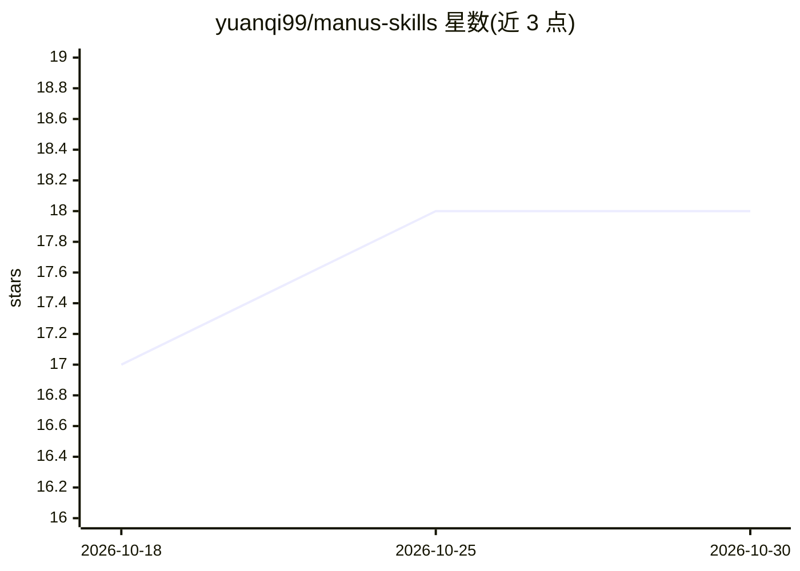

# yuanqi99/manus-skills

⭐ 18 · Python · MIT · 推送 2026-02-09 · [GitHub](https://github.com/yuanqi99/manus-skills) · 个人维护 · 中文 README

**面向 Manus 等平台的可复用 AI agent 技能与独立 CLI 工具集**

聚合 AI agent 技能与独立命令行工具的仓库：每项技能设计用于 Manus 平台（放入 /home/ubuntu/skills/ 即可被检测），同时以独立 Python CLI 工具形式发布，可在 Claude Code、Qodo、Cursor、Windsurf 或普通终端/CI 中运行。当前含 pdf-watermark-remover（去除 PDF 平铺图案与半透明文字水印，状态 Stable）与 claude-code-extensions（Claude Code 记忆增强插件与技能，状态 Active）。安装方式为 git clone 后 pip 安装或直接运行脚本，MIT 许可。

## 筛选速览

| 维度 | 判定 | 备注 |
|---|---|---|
| AI 角色 | `ai-ecosystem` | LLM/agent 周边工具 |
| 许可风险 | `permissive` | MIT |
| 部署形态 | `library` | 以包/库形式分发 |
| 模型依赖 | — | README 未给出锁定关系 |
| 硬件要求 | — | 无带数字的原话,不猜 |
| 安装摩擦 | `low` | 无编译、无系统依赖或容器化 |
| 成熟度 | — | 结构信号不足 |

## 能力要点

- pdf-watermark-remover：去除 PDF 平铺图案与半透明文字水印
- claude-code-extensions：Claude Code 记忆增强插件与技能集合
- 每项技能既接入 Manus 平台，也可作为独立 Python CLI 在任意环境运行

## 适用场景

- 在 Manus 中复用现成技能而无需自行编写
- 在 Claude Code / Cursor 等环境中以 CLI 方式批量去除 PDF 水印
- 在终端或 CI 流水线中直接调用 PDF 处理工具

## 场景标签

`图像视频处理` `Agent 记忆` · 领域:Agent 开发

## 证据(README 行号)

> L5: A collection of reusable AI agent skills and standalone CLI tools. Each skill is designed to work seamlessly with **
> L46: Skills are automatically detected when placed in `/home/ubuntu/skills/`. Simply copy:

## 星数曲线

2026-10-18 17 → 2026-10-30 18（+1）

---
*卡片 v1 · prompt 1.4 · 生成 2026-10-29 · 置信度 high · 依据 README sha `bedf5d172caa` · [字段定义](../../DATASET.md)*
