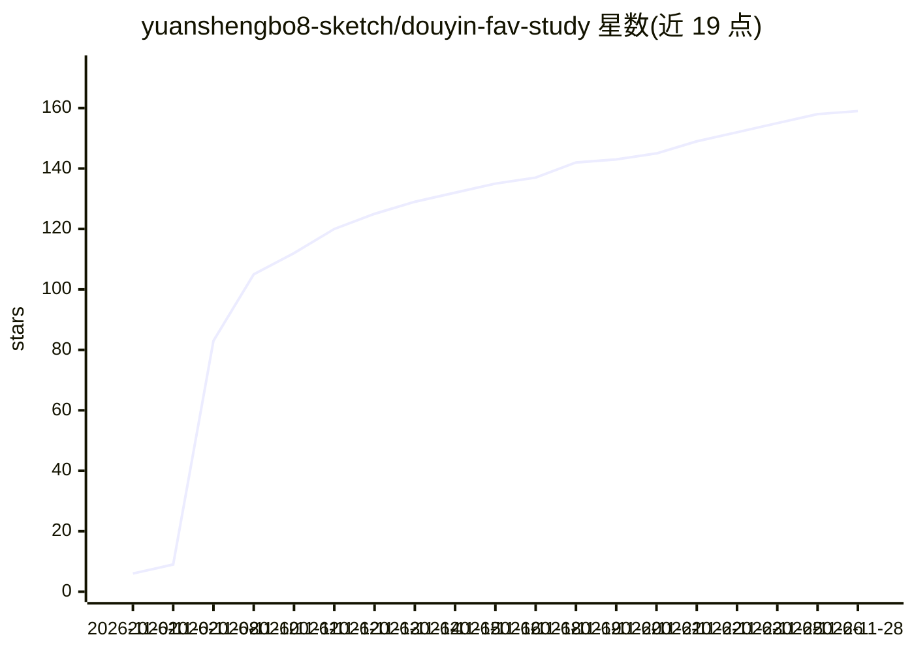

# yuanshengbo8-sketch/douyin-fav-study

⭐ 159 · Python · NOASSERTION · 推送 2026-11-10 · [GitHub](https://github.com/yuanshengbo8-sketch/douyin-fav-study) · [官网](https://github.com/yuanshengbo8-sketch/douyin-fav-study/releases/latest) · 个人维护 · 中文 README

**把抖音收藏视频/图文转为本地 AI 学习笔记的桌面工具**

面向个人学习者的桌面应用：读取抖音收藏或分享链接，下载视频与图文，在本机完成语音转文字（苹果芯片用 mlx-whisper，其他用 faster-whisper）与图片 OCR（RapidOCR/苹果系统识别），再把文字稿交给用户自选的 AI 服务商提炼总结、核心观点、自测题，并生成 Markdown 笔记与 PDF。附带带我精读、思维导图、Anki 卡片、关键词知识图谱、共识观点整理与每周周报。视频音频图片不上传，仅文字发送给 AI；笔记为普通 .md 可用 Obsidian 打开。Windows 提供一键安装包，Mac 需 Python 3.12 加安装脚本。许可为 PolyForm Noncommercial，禁止商用。

## 筛选速览

| 维度 | 判定 | 备注 |
|---|---|---|
| AI 角色 | `ai-native` | 本体是模型或模型工具 |
| 许可风险 | `none` | NOASSERTION |
| 部署形态 | `desktop` | 安装包/桌面程序 |
| 模型依赖 | locked-api |  |
| 硬件要求 | — | 无带数字的原话,不猜 |
| 安装摩擦 | `low` | 无编译、无系统依赖或容器化 |
| 成熟度 | — | 结构信号不足 |

## 能力要点

- 本机语音转写与 OCR，仅文字发送给用户自选 AI 服务商
- 笔记输出为普通 Markdown，可直接作为 Obsidian 库
- 带我精读：核心结论、时间戳大纲、追问检查、测验与 Anki 卡片
- 知识网络：按共同关键词连图谱，AI 整理多视频共识与矛盾点

## 适用场景

- 把抖音收藏的干货视频变成可复习的本地笔记
- 对长视频做带时间戳大纲的精读和自测
- 用 Obsidian 管理生成的学习笔记与图片

## 场景标签

`知识库管理` · 领域:知识与检索

## 证据(README 行号)

> L16: **抖音链接 / 收藏夹 → 下载 → 本机语音转文字 / 图片文字识别 → AI 提炼 → 学习网站 + Markdown 笔记 + PDF**
> L38: |**本机转写**：苹果芯片 Mac 用 mlx-whisper 加速，其他电脑用 faster-whisper；有字幕直接用字幕|**AI 提炼**：总结、核心观点、照着做、工具、概念、自测题，自动分类|

## 星数曲线

2026-11-01 6 → 2026-11-28 159（+153）

---
*卡片 v1 · prompt 1.4 · 生成 2026-11-17 · 置信度 mid · 依据 README sha `9369ef29e68c` · [字段定义](../../DATASET.md)*
