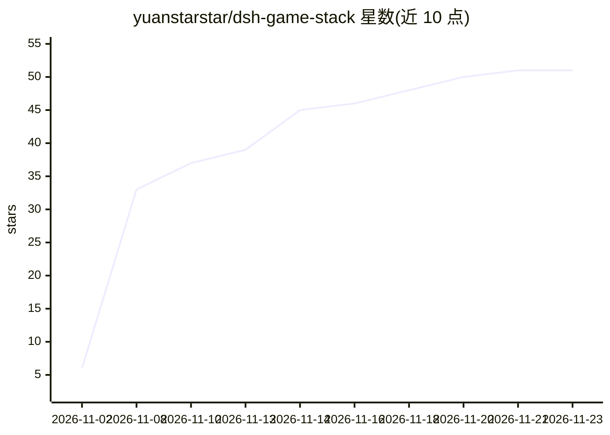

# yuanstarstar/dsh-game-stack

⭐ 51 · JavaScript · MIT · 推送 2026-11-01 · [GitHub](https://github.com/yuanstarstar/dsh-game-stack) · 个人维护 · 中文 README

**给 DSH agent 的打游戏插件合集：感知/视觉/学习/直播/启动器 5 包**

面向 DSH（deepseek-harness）的插件 bundle 合集，含 5 个可安装包：coach_* 抓帧/OCR/点击按键驱动游戏并锚定 OBS；cv_* 把画面编译成实体包以减少视觉 token 消耗；game_learn 合并规则引擎、流程状态机、四道闸门与知识库；live_bridge 读 B 站弹幕与 TTS 语音；launcher 负责游戏安装与实例管理。约 2.0 MB / 145 个文件，附一键安装脚本；coach_* 依赖 Python 3.10+ / numpy / Pillow，凭证与游戏素材不入包。

## 筛选速览

| 维度 | 判定 | 备注 |
|---|---|---|
| AI 角色 | `ai-ecosystem` | LLM/agent 周边工具 |
| 许可风险 | `permissive` | MIT |
| 部署形态 | `None` |  |
| 模型依赖 | — | README 未给出锁定关系 |
| 硬件要求 | — | 无带数字的原话,不猜 |
| 安装摩擦 | `low` | 无编译、无系统依赖或容器化 |
| 成熟度 | — | 结构信号不足 |

## 能力要点

- coach_* 约 25 个工具：抓帧、OCR、点击、按键、场景识别、OBS 锚定
- cv_* 将画面编译为实体包，之后零视觉 token 读盘面（按分辨率写死）
- 游戏学习包合一：规则引擎 + 流程状态机 + 四道闸门 + 知识库
- 数据落 %USERPROFILE%\.dsh\ 下，升级重装不丢，旧台账可直接复用

## 适用场景

- 为 DSH agent 配齐打游戏所需的感知与操作能力
- 让 agent 通过规则与流程闸门学习并执行游戏策略
- 直播场景下读弹幕并语音播报，配合游戏自动运行

## 场景标签

`GUI 自动化` `语音合成` · 领域:效率与自动化

## 证据(README 行号)

> L3: 对应 `docs/DSH通用打游戏-插件经验报告.md` 的七个章节，收成 **5 个可安装 bundle**。
> L8: |§2.1 `coach_*`|`01-coach-perceive/`|`@local/dsh-coach-perceive-v3` 0.2.0|眼睛和手：抓帧、OCR、点击、按键、驱动推剧情、OBS 锚定|Python 3.10
> L10: |§2.3+§2.4+§2.5|`02-game-learn/`|`@local/dsh-game-learn-v2` 0.2.1|规则引擎 + 流程状态机 + 四道闸门 + 知识库（合一）|纯 JS，无依赖|

## 星数曲线

2026-11-02 6 → 2026-11-23 51（+45）

---
*卡片 v1 · prompt 1.4 · 生成 2026-11-18 · 置信度 mid · 依据 README sha `6d2e15368df5` · [字段定义](../../DATASET.md)*
