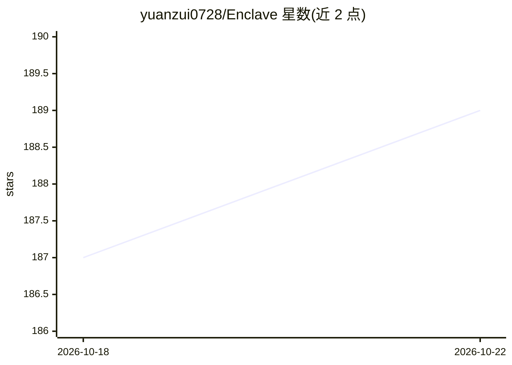

# yuanzui0728/Enclave

⭐ 189 · TypeScript · MIT · 推送 2026-06-26 · [GitHub](https://github.com/yuanzui0728/Enclave) · [官网](http://enclaveai.top/) · 个人维护 · 中文 README

**自部署的 AI 私人助手世界：AI 角色社交+知识库+代办**

开源的自托管 AI 陪伴与助手平台，作者自述为 Character.AI / Replika 的自部署开源替代。每位用户对应一个独立世界实例，内含具有人格、作息、亲密度与关系网的 AI 居民，支持聊天、群聊、AI 朋友圈与视频号等社交形态；内置四层 RAG 私人知识库、AI 笔记、文档渲染引擎（直接产出 PPT/Word/Excel）、子 agent 派活与带风险分级的行动框架。需 DeepSeek API Key 或任意 OpenAI 兼容网关，Docker Compose 一键部署，技术栈为 NestJS + React + Capacitor/Tauri，支持 Web/iOS/Android/桌面多端。

## 筛选速览

| 维度 | 判定 | 备注 |
|---|---|---|
| AI 角色 | `ai-native` | 本体是模型或模型工具 |
| 许可风险 | `permissive` | MIT |
| 部署形态 | `self-host` | docker 或自建部署 |
| 模型依赖 | locked-api |  |
| 硬件要求 | — | 无带数字的原话,不猜 |
| 安装摩擦 | `low` | 无编译、无系统依赖或容器化 |
| 成熟度 | `idea` | |

## 能力要点

- 一人一世界：单实例单主人架构，数据可导出、不用于外部训练
- AI 角色具备人格、作息、亲密度、AI 间关系网与共享世界时间
- 四层 RAG 知识底座 + 原生文档渲染（PPT/Word/Excel 异步交付）
- 带三档风险等级护栏的行动框架与赛博分身代理机制

## 适用场景

- 自部署一个 AI 陪伴与社交世界，不向中心平台交出数据
- 让 AI 专家基于私人知识库回答并直接产出 PPT/Word/Excel 文件
- 把复杂任务整包派给 AI 子 agent 并阶段性跟进

## 场景标签

 · 领域:AI 陪伴/社交应用

## 证据(README 行号)

> L49: 隐界（**Enclave**）是一个开源的、由 AI 驱动的私人助手平台 —— 可以把它理解为 **Character.AI / Replika 的自部署开源替代**，但做的不是单点对话，而是一整个"私人助手世界"：各行各业的专家
> L178: - 📊 **直接产出成果物**：在聊天里说清楚你要什么，专家居民就能产出**能直接用的 PPT、Word、Excel**——不是教你怎么做，是把做好的文件发给你。底层是一套原生文档渲染引擎（`character-skill` 模

## 星数曲线

2026-10-18 187 → 2026-10-22 189（+2）

---
*卡片 v1 · prompt 1.4 · 生成 2026-10-22 · 置信度 high · 依据 README sha `381f84e53427` · [字段定义](../../DATASET.md)*
