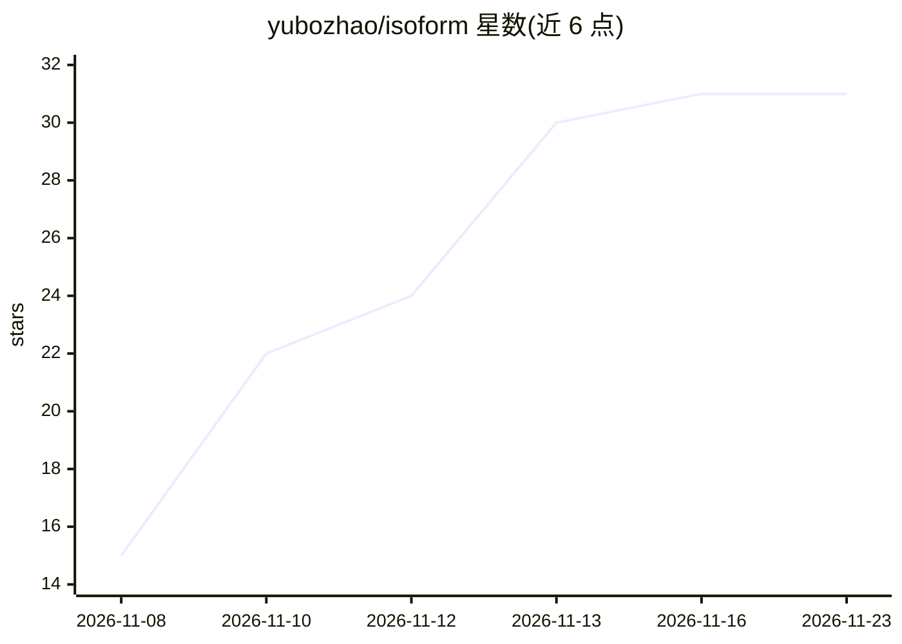

# yubozhao/isoform

⭐ 31 · Go · NOASSERTION · 推送 2026-11-18 · [GitHub](https://github.com/yubozhao/isoform) · [官网](https://www.isoform.ai) · 个人维护 · 中文 README

**本地优先的主动式个人 AI 助手：观察电脑使用并生成简报与任务**

运行在 macOS 上的个人 AI 桌面应用（配 iPhone 伴侣应用）：在本机观察屏幕与应用活动，将记忆存储在本地磁盘，生成早晚简报、待审批的回复草稿与任务。自身不内置模型，模型工作由用户已登录的 Claude Code、Codex 或本地 Ollama 承担，Isoform 负责提供上下文。观察内容中的敏感信息（密码、验证码、卡号）会被尽力过滤，数据外发范围以表格列明并可关闭。以 FSL-1.1-ALv2 许可开源，各版本两年后转为 Apache 2.0。

## 筛选速览

| 维度 | 判定 | 备注 |
|---|---|---|
| AI 角色 | `ai-native` | 本体是模型或模型工具 |
| 许可风险 | `none` | NOASSERTION |
| 部署形态 | `None` |  |
| 模型依赖 | local-ok | 支持本地模型 |
| 硬件要求 | — | 无带数字的原话,不猜 |
| 安装摩擦 | `low` | 无编译、无系统依赖或容器化 |
| 成熟度 | — | 结构信号不足 |

## 能力要点

- 早晚简报、待审批草稿与任务队列
- 记忆与截图存储在本地磁盘，可审查与纠正
- 复用已登录的 Claude Code / Codex 或本地 Ollama 作为模型后端
- 端到端加密的手机配对推送简报

## 适用场景

- 每天早晚查看工作动态与待办事项的简报
- 让 AI 基于本机上下文起草回复，本人审批后发送
- 把任务交给已登录的 Claude Code 或 Codex 执行并跟踪状态

## 场景标签

`AI 助手` `Agent 记忆` · 领域:Agent 开发

## 证据(README 行号)

> L3: A proactive personal AI. Works ahead. Lives on your computer.
> L30: Memory on disk gives you a record on your computer that you can review and control. Isoform builds on AI tools you 

## 星数曲线

2026-11-08 15 → 2026-11-23 31（+16）

---
*卡片 v1 · prompt 1.4 · 生成 2026-11-18 · 置信度 high · 依据 README sha `4e5c007e72fc` · [字段定义](../../DATASET.md)*
