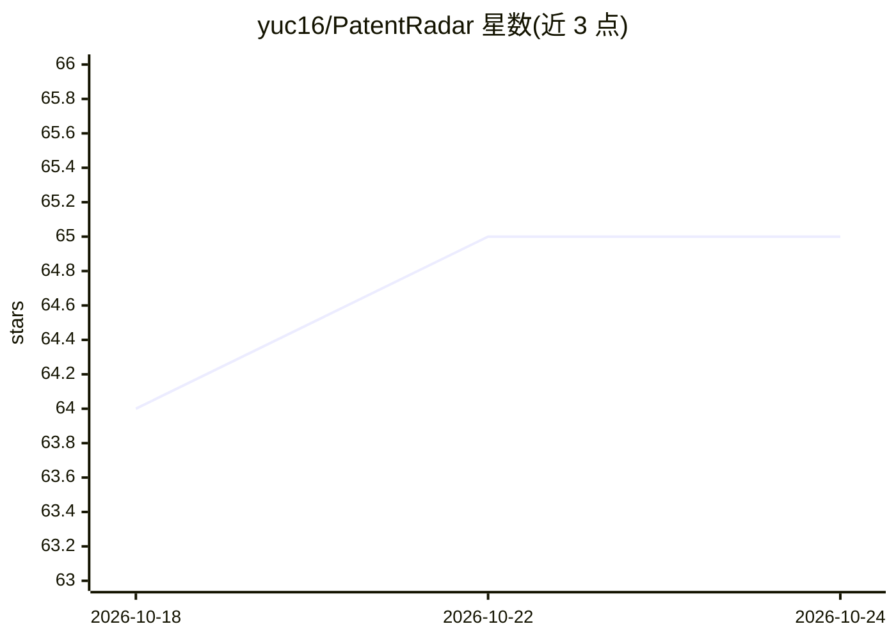

# yuc16/PatentRadar

⭐ 66 · Python · 推送 2026-08-29 · [GitHub](https://github.com/yuc16/PatentRadar) · 个人维护 · 中文 README

**输入专利公开号，自动产出竞品侵权分析报告的工具**

专利侵权竞品分析系统：输入专利公开号，经 4 模块流水线（权利要求拆解 → 竞品搜索 → 全权利要求对比 → 报告生成）产出含逐特征对比表、证据 URL 与证据缺口建议的 markdown/PDF 报告。提供独立部署（uv/Docker，Web Dashboard/HTTP API/CLI 三入口）与 skill 嵌入（Claude Code/Codex 等宿主 agent spawn subagent）两种模式。独立模式需自配 LLM 后端（chatgpt auth 或 OpenAI 兼容）与至少一个搜索 API；明确声明仅做字面初筛、不含等同侵权分析，终判需专业人员复核。

## 筛选速览

| 维度 | 判定 | 备注 |
|---|---|---|
| AI 角色 | `ai-native` | 本体是模型或模型工具 |
| 许可风险 | `none` | — |
| 部署形态 | `self-host` | docker 或自建部署 |
| 模型依赖 | — | README 未给出锁定关系 |
| 硬件要求 | — | 无带数字的原话,不猜 |
| 安装摩擦 | `low` | 无编译、无系统依赖或容器化 |
| 成熟度 | — | 结构信号不足 |

## 能力要点

- 4 模块流水线：拆解权利要求 → 竞品搜索 → 全权利要求 claim chart → PDF 报告
- 逐特征四档评分（明确满足/可能满足/证据不足/明确不满足）与三段式 reasoning
- skill 模式可被 Claude Code / Codex 等宿主 agent 调用，自动 spawn 4 个 subagent
- 9 大技术领域（动力电池/智驾等）的可配置垂类站点与图像 boost 词

## 适用场景

- 律师或 IP 团队快速生成竞品侵权初筛报告与证据清单
- 企业排查自家专利被竞品字面命中情况
- 把专利分析能力作为 skill 嵌入 agent 工作流

## 场景标签

`多智能体` `RAG` · 领域:Agent 开发

## 证据(README 行号)

> L5: 输入一个专利公开号，输出一份竞品侵权分析报告——内容包括：逐项技术特征对比表、可点击的公开证据 URL、以及“还缺什么证据 / 下一步去哪查”的可执行建议。
> L20: PatentRadar 把这条链路压到 **1 小时**：4 个模块串行流水线 + 多源搜索 + 多模态证据抓取 + 严苛评分规则，让 LLM 做"信息整理"和"逐特征对比"，把 **可追溯复核** 的 侵权分析报告直接交到律师手

## 星数曲线

2026-10-18 64 → 2026-10-24 65（+1）

---
*卡片 v1 · prompt 1.4 · 生成 2026-10-24 · 置信度 high · 依据 README sha `135070cc6109` · [字段定义](../../DATASET.md)*
