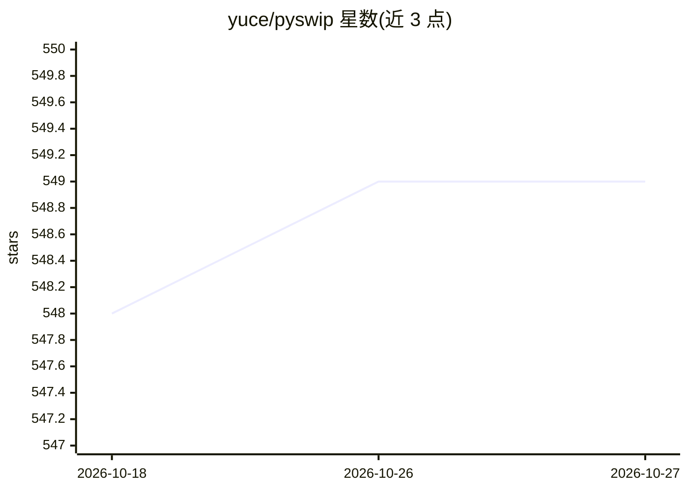

# yuce/pyswip

⭐ 549 · Python · MIT · 推送 2026-02-15 · [GitHub](https://github.com/yuce/pyswip) · [官网](https://pyswip.org) · 组织维护

**Python 调用 SWI-Prolog 的接口库，用于在 Python 中查询 Prolog**

通过 SWI-Prolog 外部语言接口与 ctypes 访问其共享库，使 Python 程序能创建 Prolog 查询、加载已有知识库文件、注册外部函数，并提供实验性的 Pythonic 接口（Functor/Variable/Query）。安装无需编译，前提是系统已装有 SWI-Prolog。由 PySwip 社区维护，MIT 许可，曾被科学论文与学位论文使用。

## 筛选速览

| 维度 | 判定 | 备注 |
|---|---|---|
| AI 角色 | `ai-ecosystem` | LLM/agent 周边工具 |
| 许可风险 | `permissive` | MIT |
| 部署形态 | `library` | 以包/库形式分发 |
| 模型依赖 | — | README 未给出锁定关系 |
| 硬件要求 | — | 无带数字的原话,不猜 |
| 安装摩擦 | `low` | 无编译、无系统依赖或容器化 |
| 成熟度 | `idea` | |

## 能力要点

- 通过 ctypes 调用 SWI-Prolog 共享库，安装无需编译
- 支持 consult 加载已有 Prolog 知识库文件并查询
- 支持注册 Python 外部函数供 Prolog 调用
- 实验性 Pythonic 接口（Functor/Variable/Query）

## 适用场景

- 在 Python 项目中嵌入 Prolog 逻辑推理与知识库查询
- 构建专家系统或逻辑编程教学示例
- 让 Prolog 程序调用 Python 实现的外部函数

## 场景标签

`知识图谱` · 领域:知识与检索

## 证据(README 行号)

> L20: PySwip is a Python-Prolog interface that enables querying SWI-Prolog in your Python programs.
> L21: It features an SWI-Prolog foreign language interface, a utility class that makes it easy querying with Prolog and a

## 星数曲线

2026-10-18 548 → 2026-10-27 549（+1）

---
*卡片 v1 · prompt 1.4 · 生成 2026-10-21 · 置信度 high · 依据 README sha `4d8ec2bd2afa` · [字段定义](../../DATASET.md)*
