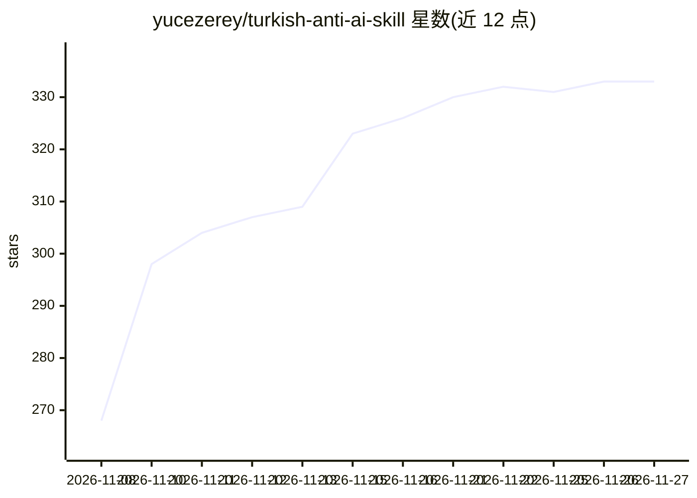

# yucezerey/turkish-anti-ai-skill

⭐ 333 · Python · MIT · 推送 2026-11-11 · [GitHub](https://github.com/yucezerey/turkish-anti-ai-skill) · 个人维护

**清除土耳其语文本中 AI 写作痕迹的 Agent Skill 与 Humanizer 包**

面向 Claude Code、Cursor、Codex、Gemini CLI 等 agent 工具的技能包，用于改写、生成和审计土耳其语文本中的 Translationese（'AI 土耳其语'）模式与 TDK 拼写错误。核心机制：SKILL.md 规则文件驱动模型按 3 层架构（修辞模板、句法形态、TDK 表面）重写，附带 60+ 模式三档词典、5 语域校准、防编造锁；另含无外部依赖的确定性 Python CLI 检测器，用正则与统计（-mAktAdIr 密度、句长 Burstiness CoV）输出报告。检测器不测句法决策，阈值可在脚本内修改。

## 筛选速览

| 维度 | 判定 | 备注 |
|---|---|---|
| AI 角色 | `ai-ecosystem` | LLM/agent 周边工具 |
| 许可风险 | `permissive` | MIT |
| 部署形态 | `library` | 以包/库形式分发 |
| 模型依赖 | — | README 未给出锁定关系 |
| 硬件要求 | — | 无带数字的原话,不猜 |
| 安装摩擦 | `low` | 无编译、无系统依赖或容器化 |
| 成熟度 | — | 结构信号不足 |

## 能力要点

- rewrite/write/audit 三种工作模式，附带防编造锁（不添加来源中不存在的事实）
- 确定性 Python CLI 检测器（无外部库），测 AI 套话、TDK 错误、-mAktAdIr 密度与 Burstiness CoV
- 60+ 模式的三档'AI 土耳其语'词典与 5 语域 × 9 风格维度校准
- 支持多种 agent 工具安装，含 Web 界面用的单文件合并版

## 适用场景

- 把 LLM 生成的土耳其语文本改写成自然的土耳其语
- 在写作或审核流程中检测文本的 AI 痕迹与 TDK 拼写错误
- 接入 CI/GitHub Actions 对 Markdown 文档做批量检测

## 场景标签

`AI 写作` `提示工程` · 领域:Agent 开发

## 证据(README 行号)

> L4: *An open-source Agent Skill & Turkish Humanizer that removes AI writing patterns ("Yapay Zekâ Türkçesi" / Translatio
> L40: Tek satırlık *"Bunu insani ve doğal bir Türkçeyle yaz"* komutu yalnızca en bariz birkaç kelimeyi değiştirir ve çoğu
> L42: - **3 Çalışma Modu (`rewrite`, `write`, `audit`):** Mevcut metni olgusal sadakatle onarır (`rewrite`), sıfırdan Tür

## 星数曲线

2026-11-08 268 → 2026-11-27 333（+65）

---
*卡片 v1 · prompt 1.4 · 生成 2026-11-17 · 置信度 high · 依据 README sha `12fcb9a74167` · [字段定义](../../DATASET.md)*
