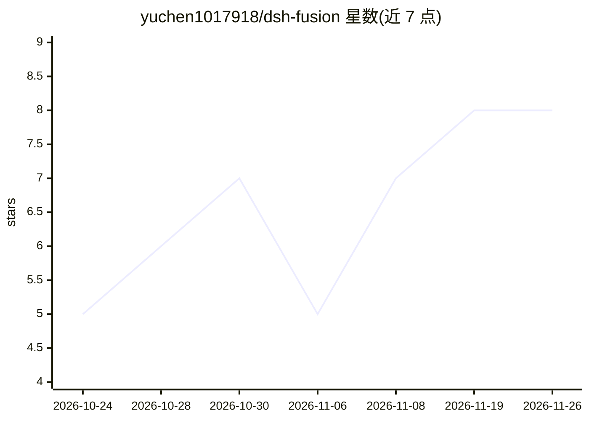

# yuchen1017918/dsh-fusion

⭐ — · [GitHub]() · 个人维护 · 中文 README

**给安卓手机安装 DeepSeek Harness 的引导安装器**

本仓库 main 分支是一个 5.43 MB 的 Android 安装器，不包含应用本体：它探测设备架构、系统版本、内存、存储与 WebView 版本，从 artifacts.json 清单匹配对应构建，经多渠道路由与断点续传下载后交给系统安装；并探测模拟器/兼容层以预判 PRoot 不可用的情况。真应用在 full-bundled 分支（双运行时、本地大模型）。纯血鸿蒙/iOS 环境由网页版判定并给出对应引导。作者声明从未在真机上验证。

## 筛选速览

| 维度 | 判定 | 备注 |
|---|---|---|
| AI 角色 | `ai-enhanced` | 去掉 AI 部分产品仍成立 |
| 许可风险 | `permissive` | — |
| 部署形态 | `None` |  |
| 模型依赖 | — | README 未给出锁定关系 |
| 硬件要求 | — | 无带数字的原话,不猜 |
| 安装摩擦 | `medium` | 含编译或系统依赖之一 |
| 成熟度 | `idea` | |

## 能力要点

- 设备探测自动匹配 arm64/x86_64 构建并预检模拟器兼容性
- .part 文件断点续传 + 多渠道路由，校验 206 Partial Content 与 sha256
- 清单驱动的架构，新增平台只需改 artifacts.json
- 提供网页版为鸿蒙/iOS 环境做安装可行性判定

## 适用场景

- 在 Android 手机上引导安装对应架构的 DSH 完整版
- 弱网环境下载大体积安装包时续传与换源
- 纯血鸿蒙设备上确认能否安装并获取替代方案

## 场景标签

 · 领域:移动开发/应用分发工具

## 证据(README 行号)

> L3: > **这个仓库的 `main` 分支不是应用本身，而是一个安装器。**
> L7: 一个把 DeepSeek Harness 装到手机上的引导程序：
> L78: |`full-bundled`|Android 一体化应用（原 main）—— 5 个模块、双运行时后端、SafeMode、本地大模型|

## 星数曲线

2026-10-24 5 → 2026-11-26 8（+3）

---
*卡片 v1 · prompt 1.4 · 生成 2026-11-20 · 置信度 high · 依据 README sha `93877dce3ecd` · [字段定义](../../DATASET.md)*
