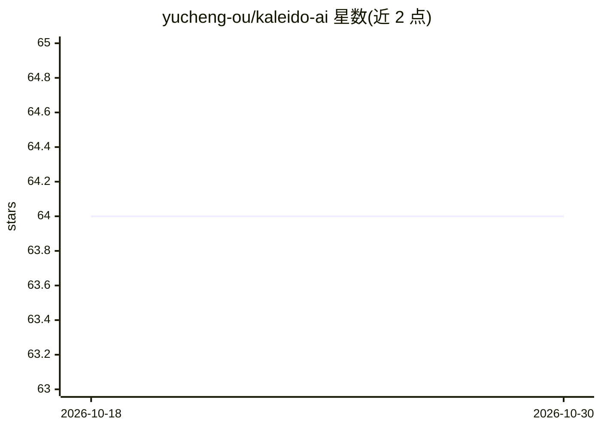

# yucheng-ou/kaleido-ai

⭐ 64 · Java · MIT · 推送 2026-03-02 · [GitHub](https://github.com/yucheng-ou/kaleido-ai) · 个人维护 · 中文 README

**微服务架构的 AI 智能衣柜：衣物管理与 AI 穿搭推荐系统**

基于 Java 21 / Spring Boot 3.5 / Spring Cloud / Spring AI 构建的微服务穿搭管理系统，采用 DDD + CQRS + 整洁架构，包含 11 个业务服务与 23 个通用模块。后台提供 RBAC 权限管理、AI Agent 创建、工作流编排与运营监控；App 客户端提供服装管理、批量导入、AI 搭配方案、风格推荐、金币激励与 AI 对话助手。AI 能力通过 Spring AI 对接 LLM（作者使用硅基流动 API）、Milvus 向量库与 RAG。部署需 Docker Compose 启动 MySQL/Redis/Nacos/MinIO 等中间件，并完成 Nacos 命名空间与配置导入、ShardingSphere 数据源与 MinIO 密钥修改等手工步骤。

## 筛选速览

| 维度 | 判定 | 备注 |
|---|---|---|
| AI 角色 | `ai-enhanced` | 去掉 AI 部分产品仍成立 |
| 许可风险 | `permissive` | MIT |
| 部署形态 | `self-host` | docker 或自建部署 |
| 模型依赖 | — | README 未给出锁定关系 |
| 硬件要求 | — | 无带数字的原话,不猜 |
| 安装摩擦 | `low` | 无编译、无系统依赖或容器化 |
| 成熟度 | — | 结构信号不足 |

## 能力要点

- 11 个微服务 + 23 个通用模块，DDD + CQRS + 整洁架构分层
- Spring AI 1.1 集成 LLM、Milvus 向量数据库与 RAG 能力
- 后台支持 AI Agent 创建管理与工作流编排引擎
- App 端提供 AI 搭配方案、风格推荐与 AI 对话助手

## 适用场景

- 管理衣橱服装并获取 AI 生成的穿搭搭配方案
- 搭建带 AI 助手与个性化推荐的穿搭管理平台
- 学习 Spring Cloud 微服务 + DDD + Spring AI 的工程实践

## 场景标签

`推荐系统` `AI 助手` · 领域:对话与助手

## 证据(README 行号)

> L19: Kaleido AI 智能衣柜是一个采用 **微服务架构** 的AI智能穿搭管理系统，基于 **DDD领域驱动设计 + CQRS + 整洁架构** 理念构建。
> L31:  - **智能搭配**：AI创建搭配方案、风格推荐
> L34:  - **智能助手**：AI对话咨询、实时穿搭建议

## 星数曲线

2026-10-18 64 → 2026-10-30 64（+0）

---
*卡片 v1 · prompt 1.4 · 生成 2026-10-24 · 置信度 low · 依据 README sha `76d27dfc1880` · [字段定义](../../DATASET.md)*
