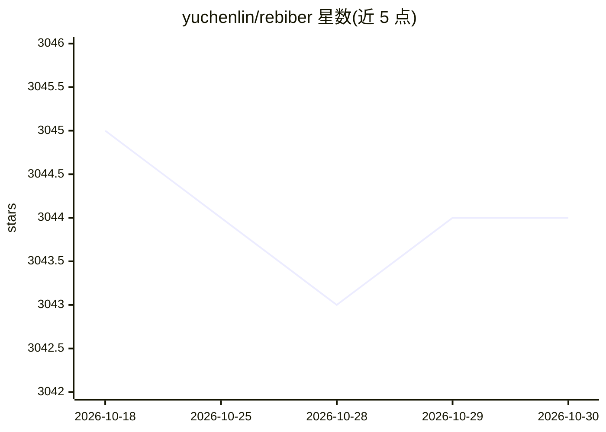

# yuchenlin/rebiber

⭐ 3,044 · Python · MIT · 推送 2026-10-26 · [GitHub](https://github.com/yuchenlin/rebiber) · [官网](https://yuchenlin.xyz/) · 个人维护

**将非正式 arXiv BibTeX 条目替换为官方 DBLP/ACL 记录的工具**

面向 LaTeX 论文作者的 .bib 文件整理工具：读取一个或多个 BibTeX 文件，将非正式/预印本条目（如 arXiv 引用）替换为 DBLP 或 ACL Anthology 官方记录，保留 cite key。匹配依据首作者姓与多个姓重叠、数字保持的标题键等守卫条件；支持 --dry-run、--live-lookup 在线查 DBLP、--format-only 完全离线模式、venue 缩写与条目排序。收录 ACL、NeurIPS、CVPR 等数十个会议的数据 dump，每月 Action 更新。仅从 GitHub 安装，PyPI 版本为 2021 年旧版不受支持。

## 筛选速览

| 维度 | 判定 | 备注 |
|---|---|---|
| AI 角色 | `ai-enhanced` | 去掉 AI 部分产品仍成立 |
| 许可风险 | `permissive` | MIT |
| 部署形态 | `library` | 以包/库形式分发 |
| 模型依赖 | — | README 未给出锁定关系 |
| 硬件要求 | — | 无带数字的原话,不猜 |
| 安装摩擦 | `low` | 无编译、无系统依赖或容器化 |
| 成熟度 | — | 结构信号不足 |

## 能力要点

- arXiv 条目替换为 DBLP/ACL Anthology 官方记录，保留 cite key
- --live-lookup 本地未命中时按标题在线查 DBLP（最多 5 条）
- --format-only 支持完全离线的纯格式化运行
- 内置数十个会议的数据 dump，月度 Action 更新

## 适用场景

- 论文投稿前把 arXiv 预印本引用换成官方出版条目
- 按 LaTeX 文件中实际引用的 key 选择性替换
- 批量整理和格式化 .bib 文件的字段与排序

## 场景标签

`科研工具` · 领域:学习与行业

## 证据(README 行号)

> L3: Replace unofficial / arXiv BibTeX entries with official DBLP or ACL Anthology records. Cite keys are kept.
> L66: Leftover unofficial arXiv entries may still query the arXiv API for year / `primaryClass`. Use `--format-only` for 

## 星数曲线

2026-10-18 3,045 → 2026-10-30 3,044（-1）

---
*卡片 v1 · prompt 1.4 · 生成 2026-10-20 · 置信度 low · 依据 README sha `7a35130985ba` · [字段定义](../../DATASET.md)*
