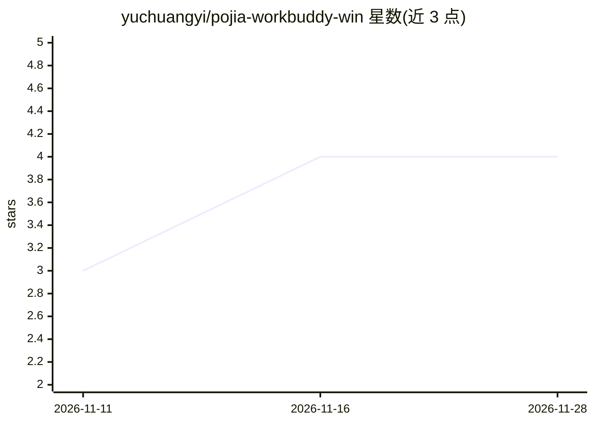

# yuchuangyi/pojia-workbuddy-win

⭐ 4 · Python · MIT · 推送 2026-11-27 · [GitHub](https://github.com/yuchuangyi/pojia-workbuddy-win) · 个人维护 · 中文 README

**给 WorkBuddy Windows 版装载提示词层的脚本工具**

面向 Windows 的 WorkBuddy 桌面版提示词层装载工具：通过 install.bat 自动定位安装目录（注册表/进程/标准路径/本地盘扫描），校验八层靶点一致性后写入修改，带 SHA256 封条与 restore.bat 一键还原。要求 WorkBuddy 桌面版至少启动过一次以生成插件缓存，写入后需完全重启 WorkBuddy 生效。提供 doctor.bat 环境自检与 --dry-run 预演，依赖 Python 3.9+ 运行。

## 筛选速览

| 维度 | 判定 | 备注 |
|---|---|---|
| AI 角色 | `ai-enhanced` | 去掉 AI 部分产品仍成立 |
| 许可风险 | `permissive` | MIT |
| 部署形态 | `desktop` | 安装包/桌面程序 |
| 模型依赖 | — | README 未给出锁定关系 |
| 硬件要求 | — | 无带数字的原话,不猜 |
| 安装摩擦 | `low` | 无编译、无系统依赖或容器化 |
| 成熟度 | — | 结构信号不足 |

## 能力要点

- install.bat 双击即装：自动定位 WorkBuddy、预演写入、逐个打印改动字节
- SHA256 封条与 restore.bat 一键还原原厂状态
- doctor.bat 15 项环境自检与 doctor.bat/DETAILS.md 排查手册
- pojia.py 提供 setup/status/doctor/restore 子命令与 --dry-run 模式

## 适用场景

- 给 WorkBuddy 桌面版装载自定义提示词模板
- 修改后想安全还原回原厂状态
- 装载失败时用 doctor.bat 自检并按手册排查

## 场景标签

`提示工程` · 领域:Agent 开发

## 证据(README 行号)

> L5: 装之前只有一件事：WorkBuddy **桌面版至少启动过一次**（脚本要读它启动时生成的插件缓存）。
> L23: 体检靶点              L8/L1/L2 数量对不上就直接停，不乱写

## 星数曲线

2026-11-11 3 → 2026-11-28 4（+1）

---
*卡片 v1 · prompt 1.4 · 生成 2026-11-21 · 置信度 mid · 依据 README sha `64eefa624228` · [字段定义](../../DATASET.md)*
