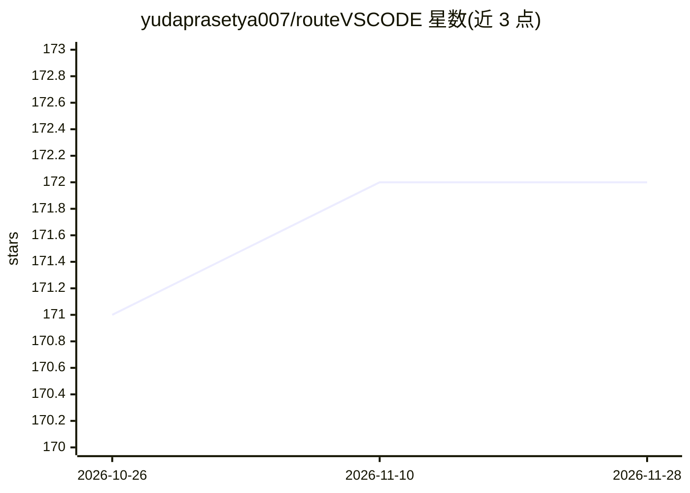

# yudaprasetya007/routeVSCODE

⭐ 172 · JavaScript · MIT · 推送 2026-10-29 · [GitHub](https://github.com/yudaprasetya007/routeVSCODE) · [官网](https://github.com/yudaprasetya007/routeVSCODE#readme) · 个人维护

**为 VSCode Copilot Chat 提供零重载切换模型与本地代理**

一个 VSCode 扩展与本地代理的组合工具，将 GitHub Copilot Chat 接入 9Router AI 网关。通过端口 20129 的本地代理动态注入模型、处理 SSE 流式与认证头，用户在 Web 仪表盘（端口 5500）或状态栏一键切换模型，无需修改 JSON 配置或重载窗口。另提供模型延迟对比与基准测试仪表盘。依赖 Node.js 与 9Router 网关，README 为印尼语，MIT 许可。

## 筛选速览

| 维度 | 判定 | 备注 |
|---|---|---|
| AI 角色 | `ai-ecosystem` | LLM/agent 周边工具 |
| 许可风险 | `permissive` | MIT |
| 部署形态 | `library` | 以包/库形式分发 |
| 模型依赖 | — | README 未给出锁定关系 |
| 硬件要求 | — | 无带数字的原话,不猜 |
| 安装摩擦 | `low` | 无编译、无系统依赖或容器化 |
| 成熟度 | — | 结构信号不足 |

## 能力要点

- 零重载模型切换：不重启 VSCode 或聊天会话即换模型
- 本地代理（端口 20129）处理模型注入、SSE 流式与认证头
- Web 仪表盘支持模型对比与延迟基准测试
- VSCode 状态栏直接切换模型

## 适用场景

- 在 Copilot Chat 中一键切换 Claude/GPT/DeepSeek 等模型
- 对比不同模型对同一提示词的响应与延迟
- 不想每次改 JSON 配置并重载 VSCode 窗口

## 场景标签

`模型网关` · 领域:Agent 开发

## 证据(README 行号)

> L21: **9Router Model Connector** adalah integrasi pintar yang menghubungkan **Visual Studio Code (GitHub Copilot Chat)**
> L31: - 🔌 **Dynamic Local Proxy (Port 20129)**: Menangani injeksi model, streaming token SSE, dan header otentikasi secar
> L43: - **Port 20128** → 9Router core engine (AI gateway & load balancer).

## 星数曲线

2026-10-26 171 → 2026-11-28 172（+1）

---
*卡片 v1 · prompt 1.4 · 生成 2026-11-26 · 置信度 high · 依据 README sha `c14bc27a5c2a` · [字段定义](../../DATASET.md)*
