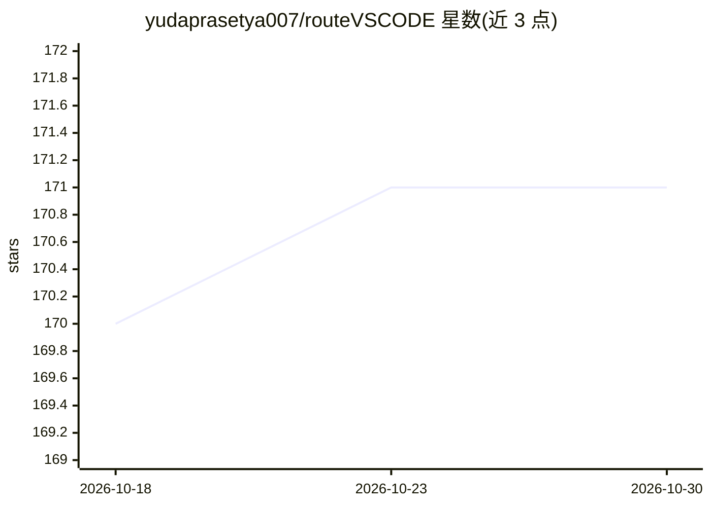

# yudaprasetya007/routeVSCODE

⭐ 171 · JavaScript · MIT · 推送 2026-10-29 · [GitHub](https://github.com/yudaprasetya007/routeVSCODE) · [官网](https://github.com/yudaprasetya007/routeVSCODE#readme) · 个人维护

**VSCode 扩展：一键零重载切换 Copilot Chat 的 AI 模型**

面向使用 GitHub Copilot Chat 的开发者的 VSCode 扩展与本地代理：通过 9Router AI 网关（端口 20128）连接 40+ 提供商（OpenAI、Anthropic、Gemini、DeepSeek、Groq、OpenRouter），本地代理（端口 20129）透明注入模型、处理 SSE 流式与认证头，实现 Web 仪表盘（端口 5500）或状态栏一键切换模型而无需重载 VSCode 或改 JSON 配置；还提供模型并行对比与延迟基准。安装含 setup 脚本、npm 全局装 9Router 与 vsix 扩展安装。

## 筛选速览

| 维度 | 判定 | 备注 |
|---|---|---|
| AI 角色 | `ai-ecosystem` | LLM/agent 周边工具 |
| 许可风险 | `permissive` | MIT |
| 部署形态 | `library` | 以包/库形式分发 |
| 模型依赖 | — | README 未给出锁定关系 |
| 硬件要求 | — | 无带数字的原话,不猜 |
| 安装摩擦 | `low` | 无编译、无系统依赖或容器化 |
| 成熟度 | — | 结构信号不足 |

## 能力要点

- 零重载动态切换 Copilot Chat 模型（仪表盘/状态栏 1 点击）
- 本地代理（端口 20129）自动处理模型注入、SSE 流式与认证头
- 经 9Router 网关接入 40+ AI 提供商
- 并排模型对比与延迟基准测试

## 适用场景

- 在 Copilot Chat 中即时切换 Claude/GPT/Gemini/DeepSeek 等模型
- 并排对比多个模型的响应与延迟
- 不改配置文件、不重启 VSCode 管理本地模型路由

## 场景标签

`模型网关` · 领域:Agent 开发

## 证据(README 行号)

> L21: **9Router Model Connector** adalah integrasi pintar yang menghubungkan **Visual Studio Code (GitHub Copilot Chat)**
> L31: - 🔌 **Dynamic Local Proxy (Port 20129)**: Menangani injeksi model, streaming token SSE, dan header otentikasi secar

## 星数曲线

2026-10-18 170 → 2026-10-30 171（+1）

---
*卡片 v1 · prompt 1.4 · 生成 2026-10-22 · 置信度 high · 依据 README sha `362259483c6e` · [字段定义](../../DATASET.md)*
