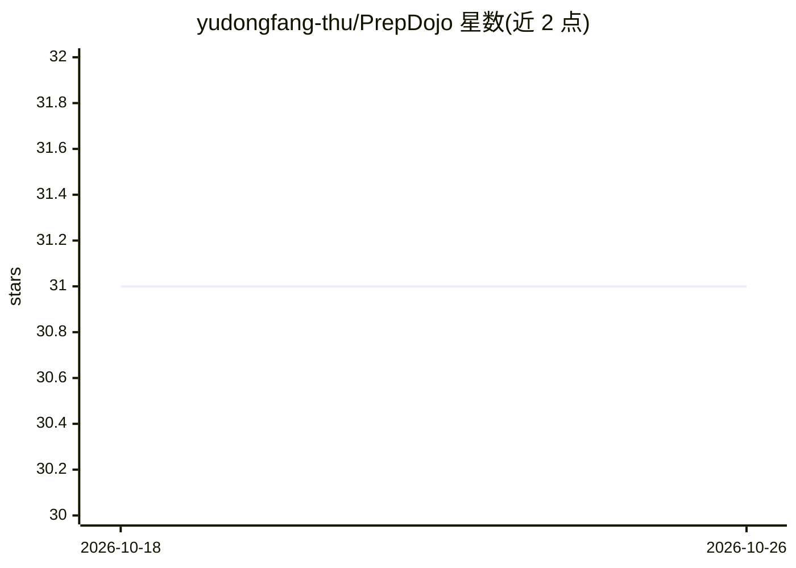

# yudongfang-thu/PrepDojo

⭐ 31 · Python · MIT · 推送 2026-08-23 · [GitHub](https://github.com/yudongfang-thu/PrepDojo) · [官网]( ) · 个人维护 · 中文 README

**本地优先的秋招刷题工具：本地沙箱判题+AI教练点评+八股陪练**

面向秋招备考者的本地刷题应用：代码题由本地沙箱（subprocess+rlimit+超时）判定 AC/WA/TLE/MLE/RE，AI 教练可自主调用沙箱工具运行代码、讲解思路、推荐更优解法；八股练习由 AI 面试官出题、打分、追问，支持将用户自有的 PDF/MD/TXT 目录经抽取、Q&A 分块、LLM 结构化后存入本地 SQLite 生成题卡。AI 模块默认使用 DeepSeek 的 OpenAI-compatible API，可配置其他端点；数据保留在本机 data/ 目录，不内置第三方题库。支持 Python 3 与 C++ 17，内置 20 道原创种子题；另有多用户 Docker 部署方案。

## 筛选速览

| 维度 | 判定 | 备注 |
|---|---|---|
| AI 角色 | `ai-native` | 本体是模型或模型工具 |
| 许可风险 | `permissive` | MIT |
| 部署形态 | `self-host` | docker 或自建部署 |
| 模型依赖 | locked-api |  |
| 硬件要求 | — | 无带数字的原话,不猜 |
| 安装摩擦 | `low` | 无编译、无系统依赖或容器化 |
| 成熟度 | — | 结构信号不足 |

## 能力要点

- 本地沙箱判题（subprocess+POSIX rlimit+超时+输出截断，五态判定）
- AI 教练可自主调用判题沙箱工具（run_code / run_problem_case）验证代码
- 知识接入流水线：PDF/MD/TXT 抽取→Q&A 分块→LLM 结构化→本地 SQLite
- AI 面试官八股陪练：出题→打分→追问，三种风格可选

## 适用场景

- 秋招备考时在本地刷代码题并获得 AI 讲解与判题报告
- 把自己的八股 PDF/笔记转成题卡进行 AI 面试陪练
- 实验室或团队小规模部署多人刷题服务

## 场景标签

 · 领域:教育/编程练习工具

## 证据(README 行号)

> L5: > **本地优先（local-first）的 AI 驱动刷题工具**：代码题本地沙箱判题，AI 教练可**自主调用判题沙箱**验证代码、讲解思路；八股由 AI 面试官出题、打分、追问；把你自己的知识目录（PDF / Markdown
> L47: ### AI 讲题教练（沙箱即工具）
> L65: ### 八股陪练（AI 面试官：出题 → 作答 → 打分 → 追问）

## 星数曲线

2026-10-18 31 → 2026-10-26 31（+0）

---
*卡片 v1 · prompt 1.4 · 生成 2026-10-26 · 置信度 mid · 依据 README sha `a717779fc5a1` · [字段定义](../../DATASET.md)*
