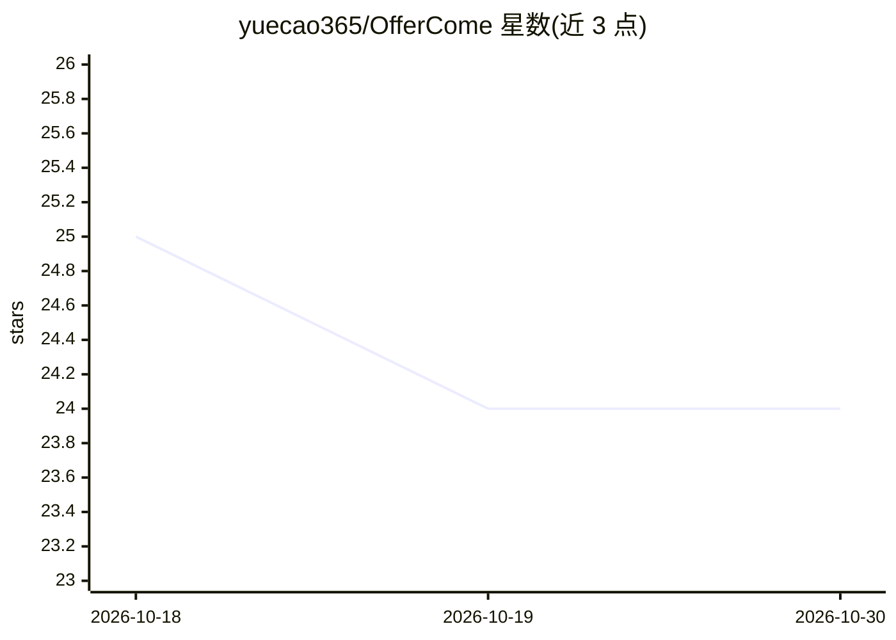

# yuecao365/OfferCome

⭐ 24 · TypeScript · MIT · 推送 2026-10-01 · [GitHub](https://github.com/yuecao365/OfferCome) · [官网](https://offercome.yuecao.dev/) · 个人维护 · 中文 README

**面向求职者的 AI 求职工作台：投递跟踪、简历管理与模拟面试**

开源 Web 应用，用 Next.js 与 SQLite 构建，将投递记录管理、简历解析（PDF/Word/图片提取实习与项目）、面试记录与 AI 模拟面试整合在一处。模拟面试为主打功能：基于简历与职位描述提问，根据回答生成追问，结束后产出总结报告；另有跨面试的题目回顾与能力画像。面试动作由代码校验、事件溯源会话记录、独立评分 agent 与 42 个面试技能包。可在浏览器直接使用或 Docker/源码自部署，模型 API 由用户在设置中自行配置。

## 筛选速览

| 维度 | 判定 | 备注 |
|---|---|---|
| AI 角色 | `ai-native` | 本体是模型或模型工具 |
| 许可风险 | `permissive` | MIT |
| 部署形态 | `self-host` | docker 或自建部署 |
| 模型依赖 | — | README 未给出锁定关系 |
| 硬件要求 | — | 无带数字的原话,不猜 |
| 安装摩擦 | `low` | 无编译、无系统依赖或容器化 |
| 成熟度 | — | 结构信号不足 |

## 能力要点

- 基于简历与职位描述的 AI 模拟面试，含追问、评分与改进建议
- 42 个按需加载的面试技能包与跨面试能力画像
- 简历从 PDF/Word/图片提取实习与项目信息
- 支持浏览器直接使用或 Docker/源码自部署

## 适用场景

- 针对目标岗位做模拟面试并获取复盘报告
- 统一管理投递进度、简历与面试笔记
- 回顾同类问题的历史回答并规划练习方向

## 场景标签

 · 领域:职业发展/求职工具

## 证据(README 行号)

> L16: Mock interviews are the main focus of development. Choose a resume and add a job description, and the AI asks about
> L55: |**AI mock interviews**|Questions based on the role and your projects, with follow-ups based on your answers. Revie

## 星数曲线

2026-10-18 25 → 2026-10-30 24（-1）

---
*卡片 v1 · prompt 1.4 · 生成 2026-10-27 · 置信度 high · 依据 README sha `c5a29394b551` · [字段定义](../../DATASET.md)*
