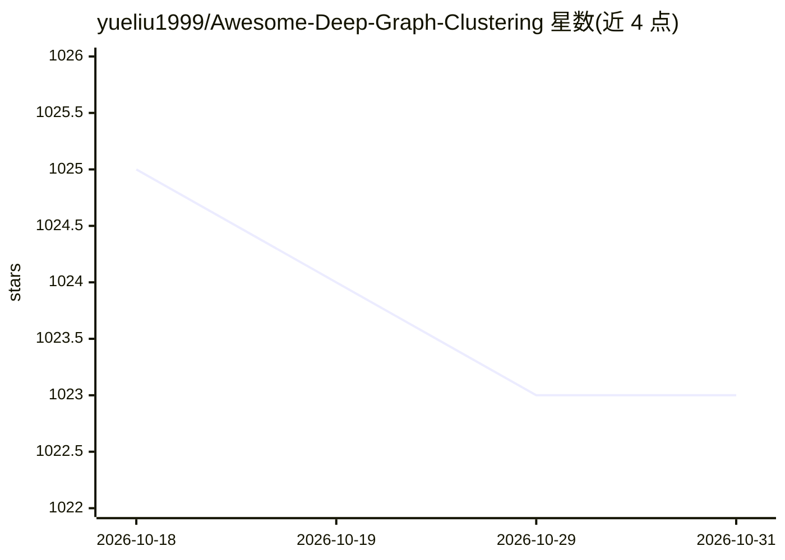

# yueliu1999/Awesome-Deep-Graph-Clustering

⭐ 1,023 · Python · MIT · 推送 2026-09-28 · [GitHub](https://github.com/yueliu1999/Awesome-Deep-Graph-Clustering) · 个人维护

**深度图聚类方法策展清单：汇总论文、代码与数据集**

收录深度图聚类领域的论文、代码与数据集的聚合清单，条目按 LLM 方法、新架构、时序图聚类、未知簇数、重构式、对抗式、对比式等类别分表组织，覆盖 2014–2026 年发表于 TPAMI、NeurIPS、ICLR、KDD 等会议期刊的工作，每条含年份、标题、发表处与论文/代码链接。同时列出综述论文与基准（如 DGCBench、BenchTGC），README 请求使用者引用其 2-3 篇论文。面向该方向的研究人员选型与文献调研。

## 筛选速览

| 维度 | 判定 | 备注 |
|---|---|---|
| AI 角色 | `ai-knowledge` | 知识聚合/清单类 |
| 许可风险 | `permissive` | MIT |
| 部署形态 | `None` |  |
| 模型依赖 | — | README 未给出锁定关系 |
| 硬件要求 | — | 无带数字的原话,不猜 |
| 安装摩擦 | `low` | 无编译、无系统依赖或容器化 |
| 成熟度 | — | 结构信号不足 |

## 能力要点

- 按 7+ 类方法体系（LLM/新架构/时序/未知簇数/重构/对抗/对比）分表组织
- 条目含论文与代码链接，覆盖 2014–2026 年工作
- 收录综述与基准论文（DGCBench、BenchTGC 等）

## 适用场景

- 查找深度图聚类方向的论文与开源代码
- 调研 LLM 用于图聚类等新方向的工作
- 选择该领域的综述与基准论文入手阅读

## 场景标签

`精选清单` `科研工具` · 领域:学习与行业

## 证据(README 行号)

> L3: ADGC is a collection of state-of-the-art (SOTA), novel deep graph clustering methods (papers, codes and datasets). A
> L12: Deep graph clustering, which aims to reveal the underlying graph structure and divide the nodes into different grou

## 星数曲线

2026-10-18 1,025 → 2026-10-31 1,023（-2）

---
*卡片 v1 · prompt 1.4 · 生成 2026-10-21 · 置信度 high · 依据 README sha `be0599aba331` · [字段定义](../../DATASET.md)*
