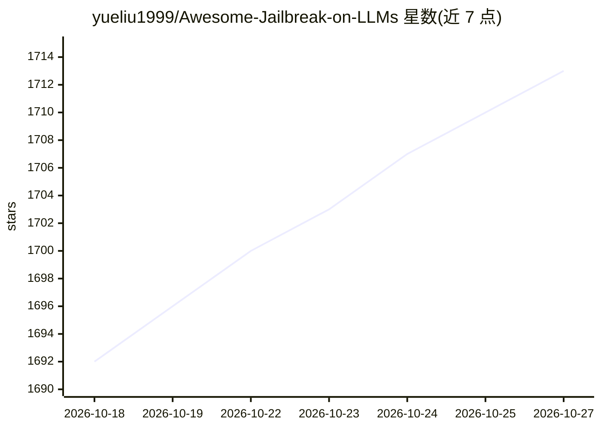

# yueliu1999/Awesome-Jailbreak-on-LLMs

⭐ 1,713 · MIT · 推送 2026-10-26 · [GitHub](https://github.com/yueliu1999/Awesome-Jailbreak-on-LLMs) · 个人维护

**面向科研者的 LLM 越狱攻击/防御论文清单**

由 NUS 研究者维护的 LLM 越狱方法资源集合，收录论文、代码、数据集、评测与分析，按攻击类型（推理模型攻击、黑盒攻击等）与防御等类别组织成表格，含时间、标题、会议、论文与代码链接，覆盖文本与多模态模型。README 提及两篇可引用论文（含 GuardReasoner-Omni 护栏工作），欢迎社区通过 PR 补充条目。面向 LLM 安全研究者与红队评测人员。

## 筛选速览

| 维度 | 判定 | 备注 |
|---|---|---|
| AI 角色 | `ai-knowledge` | 知识聚合/清单类 |
| 许可风险 | `permissive` | MIT |
| 部署形态 | `None` |  |
| 模型依赖 | — | README 未给出锁定关系 |
| 硬件要求 | — | 无带数字的原话,不猜 |
| 安装摩擦 | `low` | 无编译、无系统依赖或容器化 |
| 成熟度 | — | 结构信号不足 |

## 能力要点

- 按攻击类型分类的论文表格（时间/标题/会议/论文/代码链接）
- 覆盖推理模型（LRM）攻击与黑盒攻击等类别
- 含论文、代码、数据集、评测与分析多种资源

## 适用场景

- 查找 LLM 越狱攻击与防御方向的论文和代码
- 跟进推理模型时代的新型越狱方法
- 为 LLM 安全评测选取基线攻击方法

## 场景标签

`精选清单` `网络安全` `科研工具` · 领域:学习与行业

## 证据(README 行号)

> L3: Awesome-Jailbreak-on-LLMs is a collection of state-of-the-art, novel, exciting jailbreak methods on LLMs. It contain
> L22: ### Jailbreak Attack

## 星数曲线

2026-10-18 1,692 → 2026-10-27 1,713（+21）

---
*卡片 v1 · prompt 1.4 · 生成 2026-10-21 · 置信度 high · 依据 README sha `742dfad063ef` · [字段定义](../../DATASET.md)*
