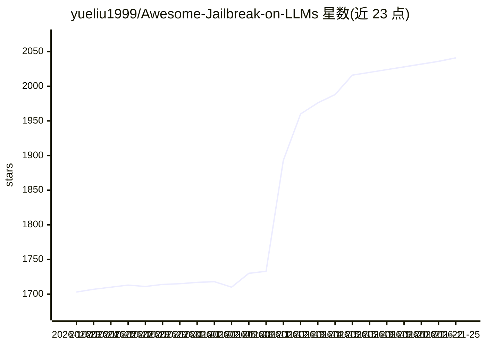

# yueliu1999/Awesome-Jailbreak-on-LLMs

⭐ 2,041 · MIT · 推送 2026-11-08 · [GitHub](https://github.com/yueliu1999/Awesome-Jailbreak-on-LLMs) · 组织维护

**LLM 越狱攻击方法论文/代码/数据集汇总清单**

面向安全研究人员整理的 LLM 越狱方法聚合清单，收录论文、代码、数据集、评估与分析，并按攻击类型组织（如对大型推理模型的攻击、黑盒攻击等），每条含时间、发表会议、论文与代码链接。维护者鼓励通过 PR/issue 贡献补充，并给出关联论文（GuardReasoner-Omni 多模态防护模型）供引用。以 Markdown 清单形式提供，无安装与运行内容。

## 筛选速览

| 维度 | 判定 | 备注 |
|---|---|---|
| AI 角色 | `ai-knowledge` | 知识聚合/清单类 |
| 许可风险 | `permissive` | MIT |
| 部署形态 | `None` |  |
| 模型依赖 | — | README 未给出锁定关系 |
| 硬件要求 | — | 无带数字的原话,不猜 |
| 安装摩擦 | `low` | 无编译、无系统依赖或容器化 |
| 成熟度 | — | 结构信号不足 |

## 能力要点

- 收录越狱攻击论文并附代码/数据集链接
- 按攻击类别（LRM 攻击、黑盒攻击等）分类组织
- 持续更新并通过 PR/issue 接受社区贡献
- 引用关联的 GuardReasoner-Omni 防护研究

## 适用场景

- 调研 LLM 安全对齐与越狱攻击研究进展
- 查找某类攻击方法的原始论文与开源实现
- 为安全评估选取基准数据集与攻击方法

## 场景标签

`网络安全` `精选清单` · 领域:学习与行业

## 证据(README 行号)

> L3: Awesome-Jailbreak-on-LLMs is a collection of state-of-the-art, novel, exciting jailbreak methods on LLMs. It contain
> L22: ### Jailbreak Attack

## 星数曲线

2026-10-23 1,703 → 2026-11-25 2,041（+338）

---
*卡片 v1 · prompt 1.4 · 生成 2026-11-23 · 置信度 high · 依据 README sha `50a59d7a508a` · [字段定义](../../DATASET.md)*
