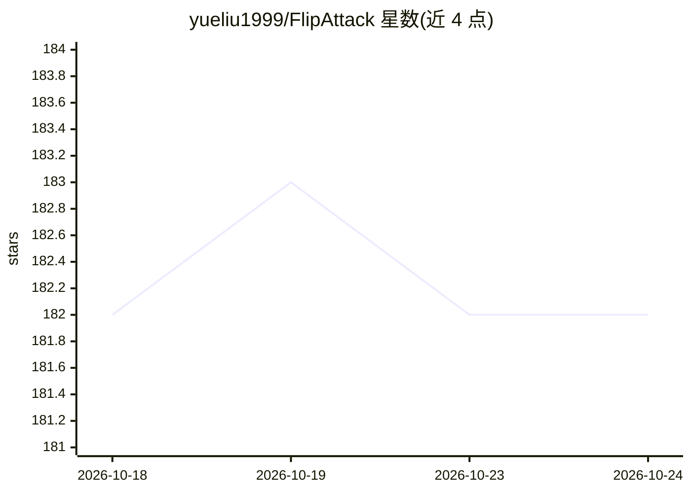

# yueliu1999/FlipAttack

⭐ 182 · Python · MIT · 推送 2026-08-11 · [GitHub](https://github.com/yueliu1999/FlipAttack) · 组织维护

**ICML 2025 论文官方代码：通过文本翻转对黑盒 LLM 实施越狱攻击**

新加坡国立大学团队的 ICML 2025 论文 FlipAttack 官方源码。方法：利用 LLM 自回归从左到右理解的特性，在提示左侧构造基于提示自身的噪声（4 种翻转模式），引导 LLM 去噪、理解并执行有害行为，从而在单次查询内越狱黑盒 LLM。提供评估脚本（ASR-GPT/ASR-DICT，基于 AdvBench）与开发版本；运行需自备 OpenAI、Anthropic、DeepInfra 的 API key。附带发布于 Hugging Face 的 45k 攻击样本数据集 FlipGuardData。

## 筛选速览

| 维度 | 判定 | 备注 |
|---|---|---|
| AI 角色 | `ai-knowledge` | 知识聚合/清单类 |
| 许可风险 | `permissive` | MIT |
| 部署形态 | `library` | 以包/库形式分发 |
| 模型依赖 | — | README 未给出锁定关系 |
| 硬件要求 | — | 无带数字的原话,不猜 |
| 安装摩擦 | `low` | 无编译、无系统依赖或容器化 |
| 成熟度 | — | 结构信号不足 |

## 能力要点

- 4 种翻转模式构造左侧噪声，单次查询攻击黑盒 LLM
- 提供 ASR-GPT / ASR-DICT 评估脚本与并行运行脚本
- FlipGuardData 数据集：8 个 LLM 上 45k 攻击样本
- 已被合并进 PyRIT 安全测试框架

## 适用场景

- 复现论文中 8 个 LLM 上的越狱攻击成功率实验
- 评估自家 LLM 或护栏模型对翻转类越狱的防御能力
- 基于代码开发新的越狱攻击或防御研究

## 场景标签

`网络安全` · 领域:学习与行业

## 证据(README 行号)

> L9: This paper proposes a simple yet effective jailbreak attack named FlipAttack against black-box LLMs. First, from the
> L26: - (**2024/10/02**) FlipAttack is on arXiv.

## 星数曲线

2026-10-18 182 → 2026-10-24 182（+0）

---
*卡片 v1 · prompt 1.4 · 生成 2026-10-22 · 置信度 high · 依据 README sha `1c9dd535ba6a` · [字段定义](../../DATASET.md)*
