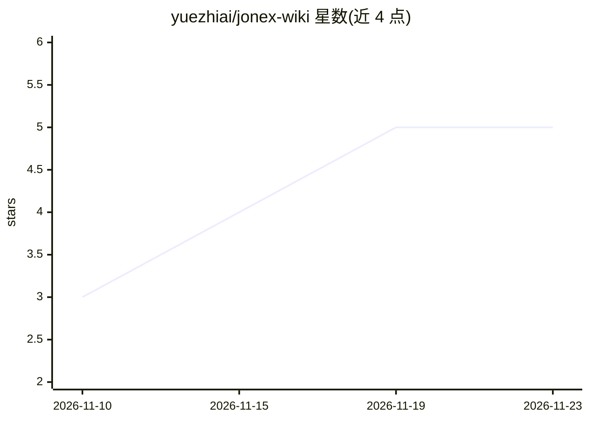

# yuezhiai/jonex-wiki

⭐ 5 · Python · Apache-2.0 · 推送 2026-11-20 · [GitHub](https://github.com/yuezhiai/jonex-wiki) · [官网](https://jonex.ai) · 组织维护 · 中文 README

**企业知识库的 LLM-Wiki 编译与可溯源问答服务**

独立的 LLM-Wiki 服务：将文档解析为结构化来源，编译为可增量更新、不可变、可版本回滚的 Wiki 包，并通过 BM25 检索与多跳遍历回答问题，引用绑定到文档、chunk、页码位置与原文摘录。不依赖特定前端，可作为独立 HTTP 服务运行，也可作为 Python 包嵌入其他应用；日常操作通过 CLI 完成上传、编译、查询与任务管理，支持多租户与 API Key 鉴权。PDF/Office/图片解析需可选的 MinerU。

## 筛选速览

| 维度 | 判定 | 备注 |
|---|---|---|
| AI 角色 | `ai-native` | 本体是模型或模型工具 |
| 许可风险 | `permissive` | Apache-2.0 |
| 部署形态 | `self-host` | docker 或自建部署 |
| 模型依赖 | — | README 未给出锁定关系 |
| 硬件要求 | — | 无带数字的原话,不猜 |
| 安装摩擦 | `low` | 无编译、无系统依赖或容器化 |
| 成熟度 | — | 结构信号不足 |

## 能力要点

- 多模态输入：txt/md/json/csv/xlsx 走确定性归一化，PDF/DOCX/PPTX/图片/HTML 经 MinerU 解析
- 分层编译：来源理解与页面组织分离，支持增量编译、单文档重编译与版本回滚
- 可溯源引用：答案引用绑定到具体文档、chunk、页码/位置与原文摘录
- 内置 BM25 检索与多跳遍历，无需向量数据库

## 适用场景

- 把企业散落的文档编译成结构化 Wiki 知识库
- 基于自有文档提问并获得可核验的引用出处
- 以 HTTP API 或 Python 包形式嵌入现有应用

## 场景标签

`文档解析` `RAG` `文档问答` `知识库管理` · 领域:知识与检索

## 证据(README 行号)

> L26: Jonex Wiki is a standalone **LLM-Wiki** service. It parses documents into structured sources, compiles them into in
> L36: - **Traceable citations**: answer citations bind to specific documents, chunks, page numbers/locations, and source 
> L37: - **Retrieval**: built-in BM25 lexical retrieval, evidence handles, and multi-hop traversal; no vector database req

## 星数曲线

2026-11-10 3 → 2026-11-23 5（+2）

---
*卡片 v1 · prompt 1.4 · 生成 2026-11-20 · 置信度 high · 依据 README sha `75d0f5888740` · [字段定义](../../DATASET.md)*
