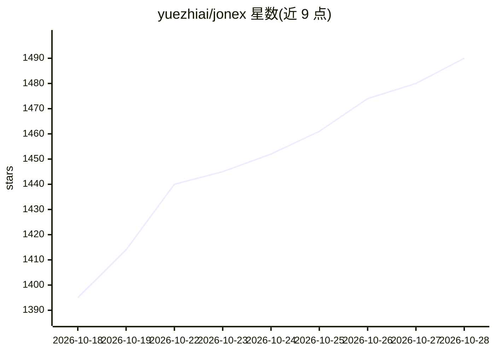

# yuezhiai/jonex

⭐ 1,490 · Python · NOASSERTION · 推送 2026-10-21 · [GitHub](https://github.com/yuezhiai/jonex) · [官网](https://jonex.ai) · 组织维护 · 中文 README

**面向企业 Agent 的多模态领域知识引擎（解析+本体知识库）**

一体化企业 AI 知识平台：整合多模态数据摄取、文档/视频解析（Atomic RAG、ASR、视觉语言模型）、本体知识编译、向量（Milvus）与图（Neo4j）索引、带溯源的知识检索与反馈闭环。通过 Docker Compose 部署全栈（含 LLM 网关、MCP server），要求配置至少一个 OpenAI 兼容的 LLM 与 embedding 服务；多租户、统一 API 网关，面向为企业 Agent 提供可推理、可追溯知识服务的场景。许可为基于 Apache 2.0 附加条件的 Jonex Open Source License。

## 筛选速览

| 维度 | 判定 | 备注 |
|---|---|---|
| AI 角色 | `ai-native` | 本体是模型或模型工具 |
| 许可风险 | `none` | NOASSERTION |
| 部署形态 | `self-host` | docker 或自建部署 |
| 模型依赖 | — | README 未给出锁定关系 |
| 硬件要求 | — | 无带数字的原话,不猜 |
| 安装摩擦 | `low` | 无编译、无系统依赖或容器化 |
| 成熟度 | — | 结构信号不足 |

## 能力要点

- 多模态解析引擎：文档、视频（ASR/关键帧/VLM）、云或本地处理
- 本体编译 + 图/向量双索引（Neo4j、Milvus 打包集成）
- 带结构化来源引用与推理轨迹的本体优先知识检索
- Docker Compose 一键部署，多租户就绪，统一 API 网关

## 适用场景

- 企业构建带溯源与本体组织的领域知识库
- 为 Agent 提供可调用、可审计的知识检索服务
- 统一处理文档与视频等多模态内容并生成知识图谱

## 场景标签

`知识图谱` `RAG` `文档解析` · 领域:知识与检索

## 证据(README 行号)

> L30: Jonex unifies an all-in-one multimodal parsing engine with an AI-ready knowledge engine. Ontology compiles domain r
> L32: It is an end-to-end enterprise AI knowledge platform that turns raw content into reusable knowledge services. Jonex
> L254: *Providing enterprise Agents with ontology-powered knowledge services that are reasoning-ready, traceable, and cal

## 星数曲线

2026-10-18 1,395 → 2026-10-28 1,490（+95）

---
*卡片 v1 · prompt 1.4 · 生成 2026-10-21 · 置信度 high · 依据 README sha `d0f5aaa616d1` · [字段定义](../../DATASET.md)*
