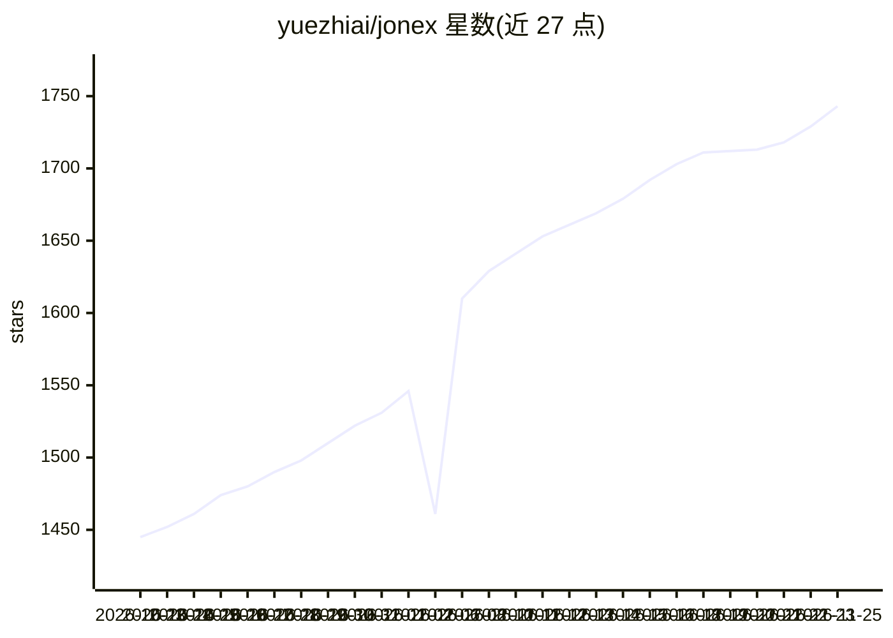

# yuezhiai/jonex

⭐ 1,743 · Python · NOASSERTION · 推送 2026-11-20 · [GitHub](https://github.com/yuezhiai/jonex) · [官网](https://jonex.ai) · 组织维护 · 中文 README

**给企业 Agent 提供本体驱动的多模态知识服务引擎**

Jonex 是端到端的企业 AI 知识平台，将数据接入、多模态解析、领域知识编译、向量与图索引、带来源引用的检索和业务应用统一在一个治理体系中。核心机制是 Jonex Wiki（遵循 OKF 格式的 LLM Wiki 处理引擎）与图本体双引擎，在检索前把领域推理编译进知识层。通过 Docker Compose 部署，多租户就绪，提供统一网关 API 与 Knowledge Search 问答；解析可 CPU 运行，GPU 加速为可选项。许可证为基于 Apache 2.0 附加条件的 Jonex Open Source License。

## 筛选速览

| 维度 | 判定 | 备注 |
|---|---|---|
| AI 角色 | `ai-ecosystem` | LLM/agent 周边工具 |
| 许可风险 | `none` | NOASSERTION |
| 部署形态 | `self-host` | docker 或自建部署 |
| 模型依赖 | — | README 未给出锁定关系 |
| 硬件要求 | — | 无带数字的原话,不猜 |
| 安装摩擦 | `low` | 无编译、无系统依赖或容器化 |
| 成熟度 | — | 结构信号不足 |

## 能力要点

- 本体+Wiki 双引擎：检索前将领域推理编译进知识层
- 多模态解析支持文档、音视频（ASR/关键帧/VLM），解析 worker 可独立扩缩
- 统一网关 API 返回答案、本体实例、RAG 用量与结构化来源引用
- 多租户就绪，支持 REST API 与 S3 兼容数据源接入

## 适用场景

- 给企业内部 Agent 提供可溯源、可调用的知识服务
- 把文档/音视频原始内容加工成结构化知识库与知识图谱
- 搭建带引用核查与反馈闭环的企业知识问答系统

## 场景标签

`知识图谱` `RAG` `文档问答` · 领域:知识与检索

## 证据(README 行号)

> L4:  Built for Enterprise Agents · Powered by the Dual Engines of Jonex Wiki and Graph Ontology
> L32: It is an end-to-end enterprise AI knowledge platform that turns raw content into reusable knowledge services. Jonex
> L260: *Providing enterprise Agents with ontology-powered knowledge services that are reasoning-ready, traceable, and cal

## 星数曲线

2026-10-23 1,445 → 2026-11-25 1,743（+298）

---
*卡片 v1 · prompt 1.4 · 生成 2026-11-23 · 置信度 high · 依据 README sha `7717e5cfab59` · [字段定义](../../DATASET.md)*
