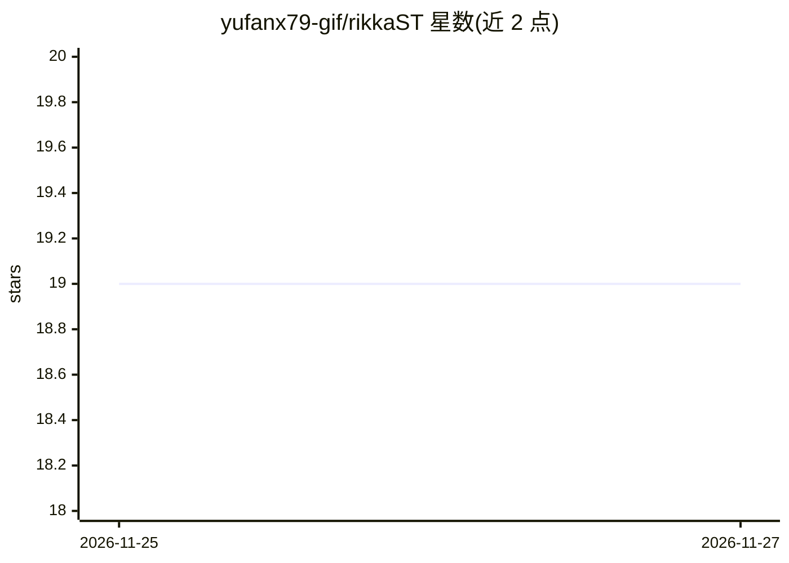

# yufanx79-gif/rikkaST

⭐ 19 · Kotlin · AGPL-3.0 · 推送 2026-11-26 · [GitHub](https://github.com/yufanx79-gif/rikkaST) · 个人维护 · 中文 README

**面向 Android 用户的酒馆角色扮演聊天客户端**

基于 RikkaHub 定制的原生 Android 大模型聊天客户端，内建 SillyTavern 兼容层，支持角色卡（V2/V3、.charx）导入编辑导出、世界书递归扫描与注入、预设管理、宏与 STscript、第三方 WebView 扩展运行时，并保留 RikkaHub 的多模型接入、工具调用、知识库（RAG）与图像生成、TTS/ASR 等能力。通过 GitHub Releases 提供 arm64-v8a 预编译 APK，可从源码用 Gradle 构建。酒馆兼容仍在开发中，服务端 API 与官方内置扩展覆盖有限。

## 筛选速览

| 维度 | 判定 | 备注 |
|---|---|---|
| AI 角色 | `ai-native` | 本体是模型或模型工具 |
| 许可风险 | `viral` | AGPL-3.0 |
| 部署形态 | `None` |  |
| 模型依赖 | — | README 未给出锁定关系 |
| 硬件要求 | — | 无带数字的原话,不猜 |
| 安装摩擦 | `low` | 无编译、无系统依赖或容器化 |
| 成熟度 | — | 结构信号不足 |

## 能力要点

- 支持 SillyTavern V2/V3 角色卡、.charx 及 PNG/JSON 导入导出
- 世界书引擎支持递归扫描、扫描深度与 token 预算
- 内置 WebView 运行时安装并运行酒馆第三方 JS 扩展
- 保留多模型提供商、工具调用与 RAG 知识库等原生能力

## 适用场景

- 在手机上导入并游玩酒馆角色卡与世界书
- 运行依赖 JS-Slash-Runner 等扩展的酒馆角色卡
- 移动端接入多模型提供商进行角色扮演对话

## 场景标签

`聊天机器人` · 领域:对话与助手

## 证据(README 行号)

> L7: rikkaST 是一个基于 RikkaHub 定制的原生 Android 大模型聊天客户端，内建 SillyTavern（酒馆）兼容层，目标是让酒馆的角色卡、世界书、预设、提示词处理和第三方扩展生态更自然地运行在手机上。
> L30: SillyTavern 的角色卡、世界书、预设、宏、正则和第三方扩展构成了一套相互关联的生态。但这套生态主要围绕网页环境构建，在手机上使用时，浏览器性能、界面交互和扩展兼容性都可能成为障碍。
> L167: - 模型与聊天：多模型提供商、流式输出、对话分支、消息编辑及重新生成等。

## 星数曲线

2026-11-25 19 → 2026-11-27 19（+0）

---
*卡片 v1 · prompt 1.4 · 生成 2026-11-24 · 置信度 high · 依据 README sha `d578ba632a6c` · [字段定义](../../DATASET.md)*
