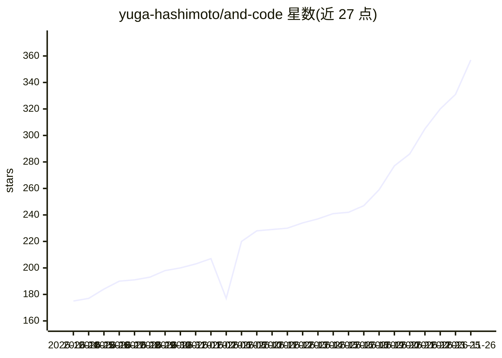

# yuga-hashimoto/and-code

⭐ 357 · Kotlin · MIT · 推送 2026-11-25 · [GitHub](https://github.com/yuga-hashimoto/and-code) · [官网](https://yuga-hashimoto.github.io/and-code/) · 个人维护

**在 Android 上本地运行 AI 编码 agent 的原生 GUI 客户端**

原生 Android GUI 应用，通过触摸界面操作 OpenCode、Claude Code、Google Antigravity、OpenAI Codex 等编码 agent，无需终端或 PC。设备端经 PRoot 在 Alpine/Debian Linux 环境内自动安装 agent 运行时，也可远程连接 PC 上的 OpenCode 服务器并中途切换运行时。提供会话管理、diff 审阅、工具审批、定时任务、语音输入/TTS、嵌入式终端与应用内浏览器预览。本身不提供模型服务，认证与推理由对应官方 CLI 处理。

## 筛选速览

| 维度 | 判定 | 备注 |
|---|---|---|
| AI 角色 | `ai-ecosystem` | LLM/agent 周边工具 |
| 许可风险 | `permissive` | MIT |
| 部署形态 | `library` | 以包/库形式分发 |
| 模型依赖 | — | README 未给出锁定关系 |
| 硬件要求 | — | 无带数字的原话,不猜 |
| 安装摩擦 | `medium` | 含编译或系统依赖之一 |
| 成熟度 | — | 结构信号不足 |

## 能力要点

- 四种编码 agent 的设备端运行（PRoot + Alpine Linux，自动下载安装并校验 SHA-256）
- 远程连接 PC 上的 OpenCode，支持 QR/mDNS 发现与会话中途切换运行时（handoff）
- 工具审批、SSE 流式输出、结构化推理/工具时间线与定时（cron）任务
- 语音输入、唤醒词、TTS，可注册为 Android 默认数字助手

## 适用场景

- 在手机上直接与编码 agent 对话修改本地 git 仓库
- 远程操控家中 PC 上的 OpenCode 会话
- 定时自动运行提示词并查看历史运行结果

## 场景标签

`编码 Agent` · 领域:编码与开发

## 证据(README 行号)

> L10: AndCode is a native Android GUI app that brings AI coding agents to your phone. Chat with OpenCode, Claude Code, Go
> L17: > AndCode is an independent, local-first graphical interface that installs or launches supported third-party comman

## 星数曲线

2026-10-24 175 → 2026-11-26 357（+182）

---
*卡片 v1 · prompt 1.4 · 生成 2026-11-25 · 置信度 mid · 依据 README sha `4e2fcc088f42` · [字段定义](../../DATASET.md)*
