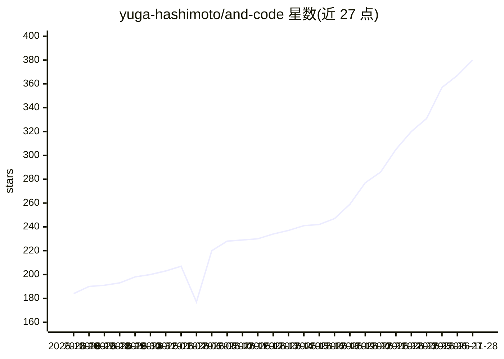

# yuga-hashimoto/and-code

⭐ 380 · Kotlin · MIT · 推送 2026-11-27 · [GitHub](https://github.com/yuga-hashimoto/and-code) · [官网](https://yuga-hashimoto.github.io/and-code/) · 个人维护

**在 Android 手机本地运行 AI 编程 agent 的原生 GUI 应用**

AndCode 是一个原生 Android 应用，通过 PRoot 在设备上构建 Alpine Linux（Antigravity 另装 Debian rootfs）环境，自动安装 OpenCode、Claude Code、Google Antigravity、OpenAI Codex 等 CLI agent，提供触摸式聊天界面、文件浏览、diff 审阅、内嵌终端、cron 定时任务、语音输入与 SSE 流式输出；也可通过 LAN/Tailscale/QR 连接 PC 上的 OpenCode 服务器并在对话中切换运行时。应用本身不提供模型服务，认证与推理由对应官方 CLI 处理。分发途径为 F-Droid 与 GitHub Releases APK，可从源码构建。

## 筛选速览

| 维度 | 判定 | 备注 |
|---|---|---|
| AI 角色 | `ai-ecosystem` | LLM/agent 周边工具 |
| 许可风险 | `permissive` | MIT |
| 部署形态 | `library` | 以包/库形式分发 |
| 模型依赖 | — | README 未给出锁定关系 |
| 硬件要求 | — | 无带数字的原话,不猜 |
| 安装摩擦 | `medium` | 含编译或系统依赖之一 |
| 成熟度 | — | 结构信号不足 |

## 能力要点

- PRoot 在 Android 设备本地运行 OpenCode/Claude Code/Antigravity/Codex，无需 PC
- 远程连接 PC 端 OpenCode，支持 LAN/Tailscale/QR 发现与对话中途运行时切换
- 工具审批机制、会话管理、cron 定时任务与唤醒词语音输入
- agent 可通过内置 MCP 服务器修改应用设置

## 适用场景

- 在没有电脑时用手机继续与编程 agent 协作改代码
- 在手机上浏览 git 仓库、审阅 agent 产生的 diff 并审批危险操作
- 通过定时任务让 agent 按计划自动运行 prompt

## 场景标签

`编码 Agent` · 领域:编码与开发

## 证据(README 行号)

> L10: AndCode is a native Android GUI app that brings AI coding agents to your phone. Chat with OpenCode, Claude Code, Go
> L45: On-device agents run inside a Linux environment via PRoot. OpenCode, Claude Code, and Codex use Alpine Linux; Googl

## 星数曲线

2026-10-26 184 → 2026-11-28 380（+196）

---
*卡片 v1 · prompt 1.4 · 生成 2026-11-27 · 置信度 mid · 依据 README sha `712ce142914e` · [字段定义](../../DATASET.md)*
