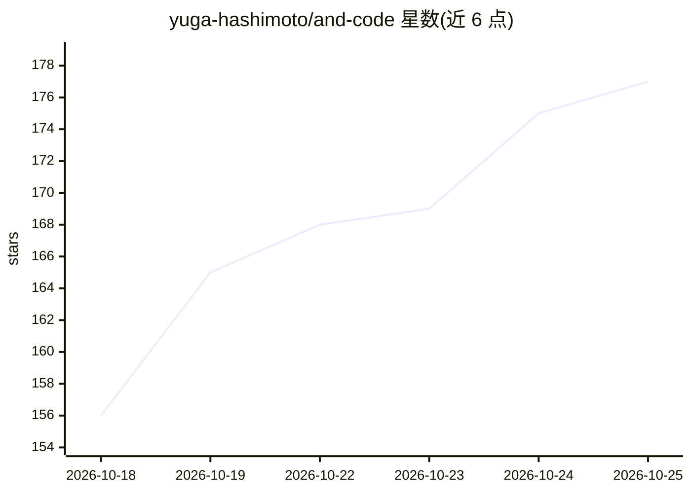

# yuga-hashimoto/and-code

⭐ 184 · Kotlin · MIT · 推送 2026-10-25 · [GitHub](https://github.com/yuga-hashimoto/and-code) · [官网](https://yuga-hashimoto.github.io/and-code/) · 个人维护 · 中文 README

**Android 原生 GUI：在手机上本地或远程运行 AI 编程 agent**

面向手机用户的 Android 原生应用，通过触控界面使用 OpenCode、Claude Code、Google Antigravity、OpenAI Codex 等命令行编程 agent。本机模式通过 PRoot 在设备上安装 Alpine/Debian Linux 运行时并下载官方 agent 二进制（SHA-256 校验）；也可连接 PC/Mac/Linux 上已运行的 OpenCode 服务器（LAN/Tailscale/QR/mDNS），支持会话中途切换运行时。功能含仓库浏览、diff 审查、工具审批、定时任务、语音输入与 TTS。应用本身不提供模型或账号，认证由用户自己的账号/API key 完成。

## 筛选速览

| 维度 | 判定 | 备注 |
|---|---|---|
| AI 角色 | `ai-ecosystem` | LLM/agent 周边工具 |
| 许可风险 | `permissive` | MIT |
| 部署形态 | `library` | 以包/库形式分发 |
| 模型依赖 | — | README 未给出锁定关系 |
| 硬件要求 | — | 无带数字的原话,不猜 |
| 安装摩擦 | `medium` | 含编译或系统依赖之一 |
| 成熟度 | — | 结构信号不足 |

## 能力要点

- PRoot 在设备上运行 Alpine/Debian Linux 以承载官方 agent CLI
- 支持 OpenCode、Claude Code、Google Antigravity、OpenAI Codex 四种 agent
- 本机与远程 PC 运行时可 mid-conversation 切换（handoff）
- 凭证以 Android Keystore 加密，无自有后端中转

## 适用场景

- 在手机上不开终端直接与编程 agent 对话改代码
- 通勤时本机运行、到家切到 PC 上的 OpenCode 继续会话
- 用定时任务自动执行周期性 prompt

## 场景标签

`编码 Agent` · 领域:编码与开发

## 证据(README 行号)

> L8: **Run coding agents locally on Android through a native GUI — no terminal required.**
> L10: AndCode is a native Android GUI app that brings AI coding agents to your phone. Chat with OpenCode, Claude Code, Go
> L228: - **Official CLIs run on-device.** OpenCode, Claude Code, Google Antigravity, and OpenAI Codex are the official, u

## 星数曲线

2026-10-18 156 → 2026-10-25 177（+21）

---
*卡片 v1 · prompt 1.4 · 生成 2026-10-22 · 置信度 mid · 依据 README sha `9697773fc177` · [字段定义](../../DATASET.md)*
