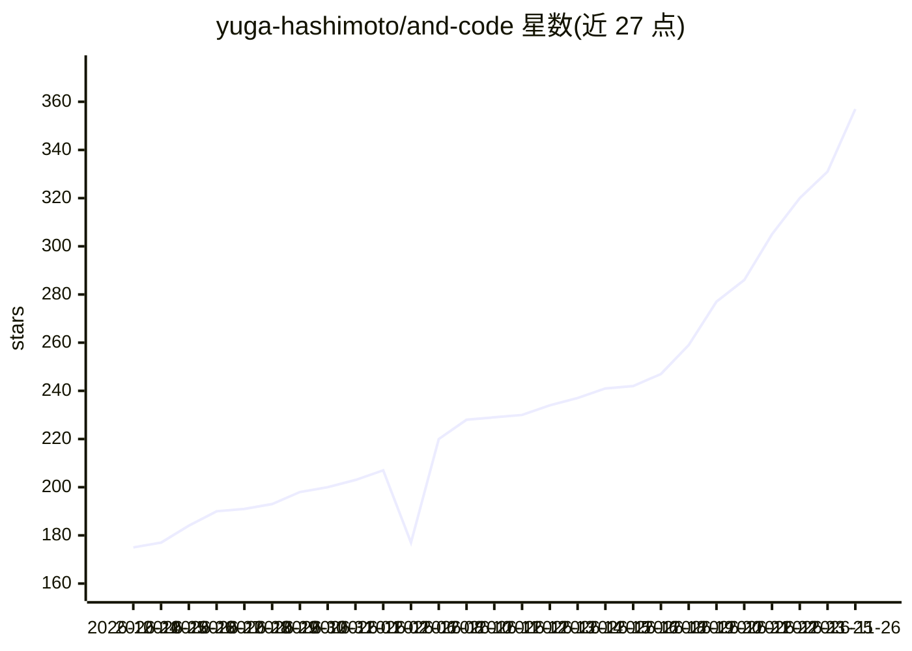

# yuga-hashimoto/and-code

⭐ 357 · Kotlin · MIT · 推送 2026-11-25 · [GitHub](https://github.com/yuga-hashimoto/and-code) · [官网](https://yuga-hashimoto.github.io/and-code/) · 个人维护

**在 Android 手机上本地运行 AI 编码代理的原生 GUI**

Kotlin/Jetpack Compose 编写的 Android 应用，通过 PRoot 在设备内运行 Alpine Linux 环境，自动安装 OpenCode、Claude Code、Google Antigravity、OpenAI Codex 四种 CLI 编码代理；也可远程连接 PC/Mac/Linux 上的 OpenCode 服务器，支持会话中途在本地与远程运行时之间切换。提供仓库浏览、diff 审查、工具审批、定时任务、语音输入、SSE 流式输出等界面能力。应用本身不提供模型或订阅服务，认证与推理由各官方 CLI 处理。发布渠道为 APK，源码构建需 JDK 17 与 Android SDK。

## 筛选速览

| 维度 | 判定 | 备注 |
|---|---|---|
| AI 角色 | `ai-ecosystem` | LLM/agent 周边工具 |
| 许可风险 | `permissive` | MIT |
| 部署形态 | `library` | 以包/库形式分发 |
| 模型依赖 | — | README 未给出锁定关系 |
| 硬件要求 | — | 无带数字的原话,不猜 |
| 安装摩擦 | `medium` | 含编译或系统依赖之一 |
| 成熟度 | — | 结构信号不足 |

## 能力要点

- 通过 PRoot 在 Android 设备内自动安装 Alpine Linux 与编码代理，无需 PC
- 支持 OpenCode（Stable）、Claude Code、Google Antigravity、Codex（Beta）
- 本地与远程 OpenCode 运行时可中途切换（handoff），支持 QR/mDNS 发现
- 工具审批、定时任务、内嵌终端、agent 驱动浏览器与语音输入

## 适用场景

- 没有电脑时在手机上与编码代理对话改代码
- 出门用手机开始会话，回家通过 handoff 在 PC 上继续
- 远程连接家里的 OpenCode 服务器做移动端运维

## 场景标签

`编码 Agent` · 领域:编码与开发

## 证据(README 行号)

> L10: AndCode is a native Android GUI app that brings AI coding agents to your phone. Chat with OpenCode, Claude Code, Go
> L17: > AndCode is an independent, local-first graphical interface that installs or launches supported third-party comman

## 星数曲线

2026-10-24 175 → 2026-11-26 357（+182）

---
*卡片 v1 · prompt 1.4 · 生成 2026-11-26 · 置信度 mid · 依据 README sha `609aed10eb81` · [字段定义](../../DATASET.md)*
